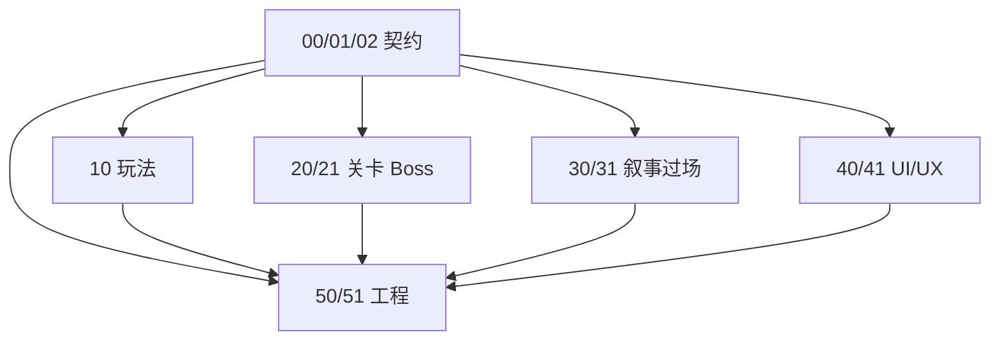

# 01 项目总览 · 《物化帝笑传》

> 一句话：把班里的梗做成一款「iwanna 式」网页闯关小游戏——精准平台跳跃 + 搞笑演出 + 每关 Boss 战 + NPC 对话，双端可玩（手机触控 / PC 键鼠），当前版本两关，第二关通关显示「未完待续」。

## 1. 核心体验

- **手感优先**：iwanna 式的短跳、土狼时间、跳跃缓冲、掉坑即死；失败立刻重试，死亡数字一直累计（笑点也是）。
- **演出驱动**：Boss 不是靠背板硬打，而是被剧情「整活」——比如笑长被 NPC 一枪带走；第二关要打到最后才发现「碰到鞋就赢了」。
- **梗不解释**：台词用原文，靠 NPC 演出和道具介绍让玩家自己会心一笑；后续可加「梗图鉴」收集。
- **可扩展**：关卡、Boss 阶段、NPC、对话、商品、梗全部是数据；加内容不改引擎代码。

## 2. 两关流程

```
标题 → 第一关（3 个平台房 + 礼堂 Boss 战）
        └─ 45s 后商店出现 → 10 金币买「子弹枪」
           → 笑长气泡「你这玩意能大四人你知道不」
           → NPC 夺枪、一枪击毙笑长（≈6s 平面动画）
           → 获得「子弹枪 / 潮的馈赠」→ 通关
     → 第二关（消耗战 Boss）
        └─ 子弹输出、躲弹幕/冲击波；受击 -1 心 -5000 金币
           → Boss ≤40% 巨大化 → 子弹刮痧
           → 碰到 Boss 的鞋 → 击败 → 「未完待续」
失败（任一）：暴露视线 2.5s / 掉坑 / 血量 0 / 金币 0 → 失败音效 + 失败卡 + 重试
```

## 3. 模块划分与文档

| 模块 | 内容 | 文档 |
|---|---|---|
| M0 总览与契约 | 全局数值、数据结构、事件、存档、扩展流程 | [02 数据契约](02-data-contracts.md) |
| M1 核心玩法 | 手感、房间/检查点、死亡与重试、金币经济、商店、物品栏、Buff/Debuff | [10 核心玩法](10-gameplay-core.md) |
| M2 关卡与 Boss | 第一关房间编排与笑长视线战；第二关攻击模式、巨大化、踩鞋 | [20 第一关](20-level1-boss.md) · [21 第二关](21-level2-boss.md) |
| M3 叙事 / NPC / 过场 / 音频 | 四位 NPC、对话系统、夺枪过场分镜、失败音效接入 | [30 NPC 与对话](30-npc-dialogue.md) · [31 过场与音频](31-cutscene-and-audio.md) |
| M4 UI/UX | 设计 token、HUD/商店/对话/物品栏、HIG 触控与安全区、Material 动效、双端布局 | [40 UI/UX](40-ui-ux.md) · [41 动效与响应式](41-motion-responsive.md) |
| M5 工程 | Kaplay 架构、目录与接口、输入抽象、音频/存档、实现任务拆解、测试与交付 | [50 工程架构](50-engine-architecture.md) · [51 质量与交付](51-quality-and-delivery.md) |

依赖关系：



## 4. 已确认的设计决策

| 决策 | 结论 |
|---|---|
| 玩法骨架 | iwanna 式房间制精准平台跳跃 + Boss 战 + NPC 对话 |
| 引擎 | KAPLAY + TypeScript + Vite，纯静态网页 |
| 平台 | 移动端（横屏触控）+ PC（键鼠）同一构建 |
| 美术 | **代码生成的扁平矢量风格**：统一色板 + 描边几何块 + 纯色/渐变，无外部图片；保留资源槽可替换 |
| 主角 | 物化帝本人 |
| UI 规范 | Apple HIG（触控 ≥44pt / 安全区 / 对比度 / 减少动效）+ Material 3 动效 token |
| 第一关失败 | 视线暴露累计 2.5s 失败；掉坑失败；无血条（只有暴露读条与金币） |
| 第二关失败 | 血量 ≤0 或金币 ≤0 任一成立 |
| 商店 | 礼堂内 45s 后出现，10 金币买子弹枪，购买即触发夺枪过场 |
| 夺枪 NPC | 「潮」：仅过场出现的蒙面剪影，无台词，击毙笑长后把枪抛回主角（道具介绍「潮的馈赠」） |
| 金币上限 | 第二关金币条封顶 20000，开局 15000（02 定） |
| 第二关胜利 | Boss ≤40% 巨大化，子弹失效，碰到鞋即胜 |
| 本轮范围 | 只交设计/开发文档，确认后再写代码 |
| 「视频」 | 指移动端/PC 适配，无视频制作 |

## 5. 里程碑

| 阶段 | 交付 | 验收门槛 |
|---|---|---|
| M0 设计文档（本轮） | 00–51 共 13 份文档 | 你确认玩法、数值、文案、UI 方向 |
| M1 可跑骨架 | 工程初始化、双端输入、房间加载、存档、移动手感 | 手机/PC 都能跑能跳、能进出房间、刷新不丢档 |
| M2 第一关 | 笑长视线战、商店购买、夺枪过场、道具获得、通关 | 完整可通关；失败可重试；手机可玩 |
| M3 第二关 | 弹幕/冲击波、双资源、巨大化、踩鞋胜利、未完待续 | 完整可通关；两种失败都触发 |
| M4 打磨 | HUD/动效/音效接入、性能、无障碍、全量测试 | 移动端 60fps、首屏 <3s、无音频不报错 |

## 6. 风险与对策

| 风险 | 影响 | 对策 |
|---|---|---|
| 梗的受众面 | 班外玩家看不懂 | 靠 NPC 演出 + 梗图鉴扩展槽降低门槛，不改原文 |
| 移动端精准度 | iwanna 高精度与触控冲突 | 56/80px 大触控区、宽容判定、辅助选项（详见 40/41） |
| 程序化矢量上限 | 画面不够「成品」 | 统一 token + 资源槽，随时替换手绘素材 |
| 无音频素材 | 体验缺失 | 音频加载器缺失静默，用户放 `public/audio/fail.ogg` 即生效 |
| 双资源平衡 | 第二关过难/过易 | 数值全在 balance.ts，单测覆盖扣款/失败判定 |
| 旧设备性能 | 掉帧 | DPR 上限 2、对象池、矢量图元数量预算（见 51） |

## 7. 需要你确认/提供的信息

**必须提供**

1. **失败音效文件**：放 `public/audio/fail.ogg` 即可（也支持 fail.mp3 / fail.m4a 兜底）；格式/文件名不同也行，告诉我就改映射。播放时机已定：失败画面出现瞬间、只播一次。
2. **第二关 Boss**：名字、外形、梗出处（现在文档用「第二关 Boss」占位）。
3. **物化帝形象**：发型、眼镜、校服颜色等，越具体越好；不给就先用几何矢量占位。

**可选/想听你的意见**

4. **更多班级梗**：想收进「梗图鉴」或彩蛋的梗（笑长、老吴、小明、食菌、假生、潮、纱魔罗托之外还有吗）。
5. 是否需要 BGM / 音效包；「梗图鉴」首版就做入口还是只留扩展槽（当前按「留入口」设计）。
6. 难度基调：当前「中等偏宽容」（第一关 3–5 分钟、首次通关死 5–10 次）；想更硬核可加即死陷阱。
7. 子弹枪默认自动装备（第二关直接可用）、死亡计数跨存档累计不清零——这两个默认值可改。
8. 第二关 15000 补给的来源文案暂定「老吴塞钱」；想换成别的梗随时说。

**已按默认拍板、不用你操心**：无 WebGL2 显示说明页；单存档位；vitest 仅作为开发依赖；静态部署用相对路径；商店面板打开时冻结世界。

## 8. 文档维护约定

- 02 是数值/数据/事件唯一事实来源；模块文档与之冲突以 02 为准。
- 新增内容走「数据 + 注册」流程，见 02 第 9 节。
- 本文档与 00-brief、02 由 Lead 维护；模块文档由各负责人维护。
