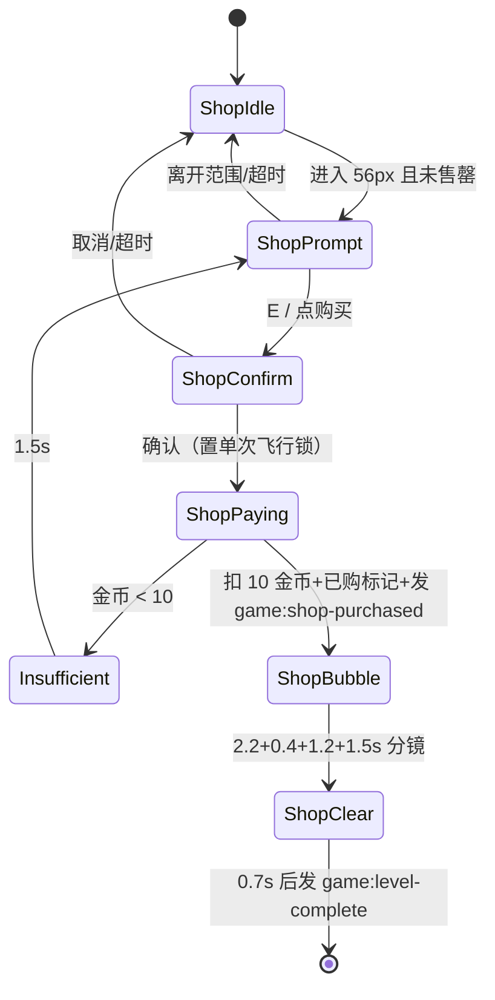

# 10 · 核心玩法系统（M1）

> 只定义「玩家能操作到什么、得到什么反馈」。已确认：主角即**物化帝本人**（文案统一用此名）；美术为**代码生成的扁平矢量风格**；无视频需求；本轮只写文档。数值以 `src/config/balance.ts` 为唯一实现来源，全局值只引用不重定义（`00-brief.md` §5）；事件名、存档 key、音频 ID 沿用简报 §4/§6。

## 1 目标与范围

**做**：iwanna 式移动手感与判定、房间制检查点与即时重试、死亡计数与「死亡数字」演出、金币经济全链路、商店购买状态机、物品栏与子弹枪跨关携带、Buff/Debuff 框架、暂停/设置、弹窗对话期间的输入封锁。

| 在范围内 | 不在范围内 |
|---|---|
| 跑/跳/短跳/土狼/缓冲/掉坑即死等判定与参数 | 瓦片坐标、房间跳台布局、Boss 弹幕编排（M2） |
| 房间检查点、重试后的重置/保留清单 | 关卡转场、整体动效风格（M4） |
| 金币产出/消耗/继承/显示、商店流程 | 第二关「15000 补给」来源文案（M3） |
| 老吴/假生数值、叙事 NPC 接口、矢量图标规格 | 商店立绘与过场分镜（M3/M4）、视频（**已确认无视频需求**） |

## 2 机制与规则

**2.1 移动手感。** 只支持左右移动 + 单段跳，无二段跳/冲刺/攀爬，空中保留水平操控。

- 地面以 `accel` 加速至 `runSpeed`，松手按 `friction` 减速；空中按方向以 `airAccel` 加速（上限仍为 `runSpeed`），无输入只有轻微 `airFriction` 衰减。
- 起跳 `vy = -jumpVel`；上升期松开跳跃键则 `vy ×= jumpCut`（每次起跳只结算一次）实现短跳；`coyote` 内离台仍可跳，`jumpBuffer` 内落地前按跳则落地瞬间起跳，两窗口按**冻结后的模拟时间**计时。
- 顶头 `vy=0` 不反弹、贴墙 `vx=0`；下落封顶 `maxFall`；不做边缘容错（`ledgeForgive=0`）。掉坑：底边低于房间底边 `fallDeathPad` 即判死，不等待落地、不要求出屏。

**2.2 房间检查点与即时重试。** 每房间一屏固定镜头；进入即登记检查点（房间 ID、入口位置、进入时金币/道具），死亡只在当前房间重开，**绝不回关卡开头**。

- 死亡 → 死亡数字 → 自动重试，无需确认；也可按「重试」/`R` 跳过等待，不加载、不重播过场。
- 重试后的重置/保留清单（实现以「房间进入快照」为准）：

| 内容 | 重试后 | 说明 |
|---|---|---|
| 玩家位置/速度/朝向、房间机关与 Boss 计时 | 重置到房间入口/初始值 | 速度清零 |
| 未拾取金币、掉落物 | 重新生成 | 已拾取的不再生成，杜绝刷币 |
| 金币余额 | **保留**（不回滚） | 第二关受击 -5000 永久生效 |
| 道具、已解锁内容、商店已购标记 | 保留 | 子弹枪不因死亡丢失 |
| HP / Buff / Debuff | HP **回满**、Buff **清除** | 第二关靠金币付代价 |
| 死亡计数 | +1（死亡瞬间已加） | 跨房间、跨关卡累计并写档 |

- 防软锁：重试时金币低于 `retryCoinFloor` 补到该值（不弹文案，仅 HUD 跳一次），避免「金币见底 → 必失败 → 无钱可捡」死循环。

**2.3 死亡计数与「死亡数字」。**

- 每次死亡 `deathCount += 1` 并写 `stats.deathCount`；HUD 右上常驻「死亡 {n}」。演出：`retryFreeze` 顿帧 → 全屏死亡数字（`deathCardDuration`，可按跳跃/点击缩到 `deathCardSkipTo`）→ 房间名淡入 → `respawnBlink` 复活闪烁；数字为超大等宽、无装饰、屏幕中线偏上，同房间连死直接换新值并轻微弹跳（减少动效时不弹），下方只留小字「死亡次数」、不写「第 n 次」。整个存档第一次死亡额外弹一句轻提示（§5.2）。

**2.4 金币经济全链路。**

| 环节 | 规则 | 来源 |
|---|---|---|
| 第一关经济 | 投放 14 枚 × 1；商店花 10；结余 4（漏捡更少，不影响购买） | 简报 §5 |
| 跨关继承 | 第二关开局金币 = 第一关结余 + 15000 补给 | 简报 §5 |
| 第二关收入 | Boss 每累计 **3 次**有效受击掉落 1 枚（`coinDrop`=2500） | 02 契约 |
| 第二关支出 | 每次受击 -1 HP 且 -5000 金币；护盾可完全抵消一次 | 简报 §5 |
| 失败条件 | HP ≤ 0 **或** 金币 ≤ 0，任一成立即失败 | 简报 §5 |
| 上限与显示 | `maxCoins` 封顶；不补零、不加千分位（如 15004） | §3.2 |

- 金币有**吸附**：进入 `coinPickupRadius` 后以 `coinMagnetSpeed` 飞向玩家，碰触即入账、播 `sfx.coin`、HUD 弹跳、发 `game:coin-changed`；扣款先校验余额，扣到 0 即触发失败判定，不存在负金币。

**2.5 商店：出现与交互。**

- 第一关商店并列取先到：Boss 房间进入后累计 45 s，或玩家踏入第 3 房间入口；触发后落在 Boss 房间内侧并发 `game:shop-opened`。触发参数归 M2，本模块只消费商店实例。
- 交互距离沿用全局 56 px；进入范围出提示，离开则提示淡出、确认气泡取消且不扣款。购买流程中移动/跳跃锁定、**伤害与视线读条暂停**、不掉坑不掉血；流程开始置 `purchaseInFlight`，连点/多点触控/键盘连按一律忽略。
- 成功后 6.0 s 过场按简报分镜（§5.3）；过场不可暂停、不可被死亡打断。买过即 `soldOut`，摊位保留并显示「已售罄」。

**2.6 物品栏与子弹枪跨关携带。** 物品栏是 `progress.items: string[]` 纯数据集合，无容量；暂停菜单「物品」页按获得顺序每道具一张卡（名称/副标题/携带标记）。

- 获得道具：写 `progress.items`、发 `game:item-acquired`、道具卡展示 2.5 s（可点击关闭），重复获得只刷新不叠加；**子弹枪**第一关购买获得，`carry: "all"`，第二关开局自动带入，跨关/跨重试/读档均保留，介绍文案固定「潮的馈赠」，第二关为默认武器、无需手动装备。

**2.7 Buff / Debuff 框架。** 统一 `BuffDef`（§7.3）数据驱动，运行时实例 `{ defId, remain, stacks, charges }`；结算钩子固定四个：**onApply / onTick / onBeforeDamage / onBeforeCoin**，新效果不得散落在引擎代码里。

| 来源 | 类型 | 效果 | 触发与限制 |
|---|---|---|---|
| 老吴（唱歌，第一关 R2） | Buff | 「纱魔罗托」：笑长视线读条增速 ×0.6（`laowuSightRampMul`），持续 25 s；重复触发刷新时长、不叠加 | 靠近 56 px 按 E；冷却 60 s，冷却中只弹短气泡 |
| 假生（问话，第二关 R1） | Debuff | -1 HP，最低保底 1 HP（不可致死），不扣金币；整段对话不可跳过（`canSkip=false`） | 靠近 56 px 按 E；一次性生效，重进只播短版 |
| 小明 / 食菌 | 纯叙事 | 无数值效果，只出语气泡/固定台词 | 靠近 56 px 按 E；不进 Buff 系统 |

- 持续时间按冻结模拟时间走：暂停冻结、切房间保留、重试清空、关卡结束清空，同 `defId` 只刷新不叠加。框架内置的 `shield`（挡 1 次伤害）/ `coinBonus`（金币 +50%）当前**仅作扩展示例**保留给后续 NPC 或道具，不挂在老吴身上；假生扣血走同一伤害管线但不扣金币，HP 到保底值时只播台词、不出扣血飘字。

**2.8 暂停、设置与输入封锁。** 入口 `Esc` / `P` / 触控右上角按钮；仅 Playing 可进入，`Dialogue/Shop/Cutscene/LevelIntro/死亡演出` 中无效（过场拒绝暂停）。

- 菜单：继续、重试本房间、设置、回到标题；「重试本房间」= 主动死亡（计数 +1、金币不回滚、HP 回满），不播 `sfx.fail`。设置：音量（0–100，默认 70）、减少动效（开/关，默认关）、控制方案（自动/键盘/触控，默认自动），改动即时生效并写档。
- 冻结范围：物理步进、全部计时器（土狼/缓冲/无敌/Buff/商店 45 s/视线读条/子弹冷却/Boss 技能）、粒子补间、SFX；BGM 压低到 30% 继续；画面压 60% 暗色遮罩，HUD 与镜头可见。恢复给 `pauseInputGuard` 静默，且不补算暂停时间。
- 输入封锁：弹窗/对话/过场/道具卡/暂停菜单/死亡演出期间玩家逻辑输入一律丢弃（不缓冲不排队，按住的方向键恢复后需重按）；菜单确认/取消始终可用，同一按键不能穿透下层；触控隐藏摇杆与跳跃键并置灰 30%，只留流程按钮。

## 3 数值与参数表

**3.1 引用简报的全局参数（不重复定义，仅声明用法）**

- `runSpeed` `accel` `friction` `gravity` `jumpVel` `jumpCut` `coyote` `jumpBuffer` `maxFall`：移动与跳跃判定（§2.1）；角色碰撞盒 20×28、交互半径 56 px：金币/商店/NPC 触发。
- 14 枚金币、商店价 10、第二关 15000、受击 -5000、`coinDrop`=2500、初始血量 5、失败条件（HP≤0 或金币≤0）：经济链与生存判定（§2.4）；6 s 商店过场分镜：§5.3。

**3.2 本模块新增参数（`balance.ts` 必须含）**

| 参数 | 默认值 | 单位 | 调参影响 |
|---|---|---|---|
| `airAccel` / `airFriction` | 2400 / 400 | px/s² | 空中操控与松手衰减；调低更硬核 |
| `ledgeForgive` | 0 | px | 边缘容错；保持 0 维持 iwanna 判定，触屏可试 4–6 |
| `fallDeathPad` | 64 | px | 低于房间底边多少判死；调大可提前救回 |
| `retryFreeze` / `deathCardDuration` / `deathCardSkipTo` | 0.12 / 1.4 / 0.2 | s | 顿帧 / 死亡数字展示 / 按键后最短停留 |
| `respawnBlink` / `roomIntroDuration` | 0.8 / 0.8 | s | 复活无敌闪烁 / 房间名淡入 |
| `coinPickupRadius` / `coinMagnetSpeed` / `coinHudBumpDuration` | 26 / 420 / 0.18 | px / px·s⁻¹ / s | 吸附距离 / 吸附速度 / 数字弹跳 |
| `maxCoins` / `retryCoinFloor` | 99999 / 2500 | 枚 | 封顶防溢出 / 重试金补底线（防软锁） |
| `bossHitsPerCoin` | 3 | 次/枚 | Boss 每几次有效受击掉 1 枚；调低则金币压力变小 |
| `damageInvuln` | 1.2 | s | 第二关受击后无敌 |
| `hitKnockbackX` / `hitKnockbackY` | 160 / 220 | px/s | 受击击退与上抛，配合冲击波躲避 |
| `interactionCooldown` / `shopExitCooldown` | 0.25 / 0.6 | s | 交互键重复触发间隔 / 离开商店后再触发冷却 |
| `shopPromptTimeout` / `shopConfirmTimeout` | 4.0 / 5.0 | s | 提示自动收起 / 确认气泡超时取消 |
| `insufficientToastDuration` | 1.5 | s | 「金币不够」停留 |
| `laowuSightRampMul` / `laowuBuffDuration` / `laowuBuffCooldown` | 0.6 / 25 / 60 | × / s / s | 视线读条增速乘数 / 增益时长 / 重复冷却；乘数调低更强 |
| `buffShieldCharges` / `buffShieldDuration` / `buffCoinBonusPct` / `buffCoinBonusDuration` | 1 / 30 / 50 / 15 | 层 / s / % / s | 通用扩展示例（护盾/金币加成），当前无 NPC 使用 |
| `jiashengHpLoss` / `jiashengHpFloor` | 1 / 1 | HP | 扣血量 / 不可致死的最低保留 |
| `pauseInputGuard` / `dtClamp` | 0.2 / 1/30 | s | 恢复输入静默 / 单帧最大步长（低帧防穿墙） |

## 4 流程与状态机

**4.1 玩家实体状态。** `Idle ⇄ Run ⇄ Air`；任意状态可被 `Locked`（对话/商店/过场/道具卡/暂停）打断；`Air → Dead`（掉坑 / HP≤0 / 视线读条满 / 金币≤0）→ `Fail → Retry → 房间入口 → Idle`。Locked 期间不可移动/跳跃、受击暂停；Dead/Paused 期间输入只保留跳过或菜单。

**4.2 死亡 → 重试时序。**

```
Death(记录原因、deathCount+1、发 game:player-died) → retryFreeze → 死亡数字(可跳过)
→ 房间重置 → 房间名淡入 → 回入口(respawnBlink) → 发 game:retry → Playing
```

- `game:player-died` 每次死亡都发；`game:fail` 在本次死亡进入 Fail/Retry 时同帧随后发出（当前两关所有死亡都满足）。失败原因枚举 `pit` / `laser` / `hp` / `coins`，文案按原因区分（§5.2）。

**4.3 商店购买状态机。**



| 迁移 | 触发 | 副作用 |
|---|---|---|
| Idle→Prompt | 进入 56 px、`!soldOut`、冷却结束 | 出提示，玩家 Locked，伤害暂停 |
| Prompt→Confirm→Paying | 交互键 → 确认 | 置 `purchaseInFlight` |
| Paying→Insufficient | 扣款前校验 `coins < 10` | 不扣款；1.5 s 后回 Prompt 并恢复操作 |
| Paying→Bubble | 扣款成功 | 写 `progress.coins/items/shopsSold`，发 `game:coin-changed`、`game:item-acquired` |
| Bubble→Clear | 定时器链 | 全程不接受输入、不可暂停、不可死亡 |
| 任意→Idle | 过场异常（仅开发断言） | 复位锁，不重复扣款 |

**4.4 暂停与设置。** Playing ⇄ Paused（继续/设置/回到标题）；「重试本房间」= 主动死亡（计数 +1，无 `sfx.fail`）；设置是 Paused 子态，仍全冻结；回标题前确认并写盘。

## 5 交互与表现

**5.1 操作映射**

| 动作 | PC | 触控 | 锁定期间 |
|---|---|---|---|
| 移动 | `A/D`、`←/→` | 左下虚拟摇杆/左右键 | 隐藏+置灰 |
| 跳跃/短跳 | `Space` / `Z` / `K` | 右下跳跃键 | 隐藏+置灰 |
| 交互 | `E` / `F` / `Enter` | 靠近后出现的按钮 | 仅流程按钮 |
| 跳过死亡演出 / 暂停 | `R` / 跳跃键；`Esc`、`P` | 点屏幕任意处；右上角按钮 | 演出中可用 |

**5.2 HUD 与死亡/重试逐字文案**

| 元素/场景 | 逐字文案 | 说明 |
|---|---|---|
| 金币 | `金币 14` | 左侧图标后，不补零、不加千分位 |
| 生命 / 死亡 | `生命 ♥♥♥♥♥` / `死亡 3` | 第二关心形，掉血变灰心；死亡右上跨关累计 |
| 道具 / 关卡名 | `子弹枪` / `第一关 · 笑长` | 右上/顶部居中淡入 `roomIntroDuration` |
| 死亡数字 | 中央超大 `{n}`，下方小字 `死亡次数`；首次死亡提示 `物化帝，掉下去就当没这回事，再来。`（整个存档一次） | 数字无花哨前缀 |
| 失败提示 | 掉坑 `物化帝掉下去了。` / 视线 `物化帝被笑长看穿了。` / 血量 `物化帝倒下了。` / 金币 `物化帝连买命钱都没了。` | 在死亡数字下方 |
| 重试 / 复活 | 触控按钮 `重试`；复活房间名 `第二关 · 房间 2/3` | 淡入结束自动消失 |

- 主角称谓：所有文案统一用「物化帝」，不改写成其他昵称。`sfx.fail` 在顿帧结束后播一次，随后出死亡数字（音频缺失静默 + 控制台 warn 一次）；减少动效时无缩放弹跳与屏幕震动，顿帧保留。

**5.3 商店逐字文案与分镜**

| 节点 | 表现 | 逐字文案 |
|---|---|---|
| 靠近提示 | 商店上方提示气泡 | PC `按 E 购买 子弹枪 · 10 金币`；触控 `点击购买 子弹枪 · 10 金币` |
| 已售罄 | 气泡变灰 | `已售罄` |
| 确认气泡 | 两行 + 两按钮 | `确定要花 10 金币买它吗？` / `买下` `算了` |
| 金币不足 | 红 Toast 1.5 s | `金币不够，还差 {n} 枚。`（n 为差额） |
| 扣款成功 | 金币 -10 飘字、武器槽亮起 | — |
| 笑长气泡 | 头顶气泡 2.2 s（逐字不改写） | `你这玩意能大四人你知道不` |
| 潮夺枪 / Boss 倒地 / 通关 | 0.4 s 枪飞出 → 1.2 s 端枪摆姿势 → 1.5 s 倒地 → 0.7 s 发 `game:level-complete` | `sfx.gunshot` / `第一关 · 过关` |
| 交互被打断 | 不出现：伤害暂停 + 输入锁定；仅开发断言记日志 | — |

- 过场总时长 6.0 s（2.2 + 0.4 + 1.2 + 1.5 + 0.7），各段硬切不叠加；`bgm.boss1` 在 Boss 倒地时停。
- 金币反馈：拾取飞入 + `+1` 飘字 + HUD 弹跳（`coinHudBumpDuration`，`sfx.coin`）；跨关入账 0.6 s 滚到总值；扣款数字变红 0.2 s 后恢复。

**5.4 道具卡与物品栏逐字**

| 字段 | 子弹枪 |
|---|---|
| 名称 / 副标题 | `子弹枪` / `潮的馈赠` |
| 描述 | `不知道谁塞给笑长的。枪口朝哪，笑长就朝哪倒。` |
| 携带标记 / 获得提示 | `第二关还能用` / `获得道具：子弹枪` |
| 物品栏标题 / 空态 | `物品` / `还没有拿到东西。` |

**5.5 Buff/Debuff 逐字与表现（Toast 2.0 s）**

| 来源 | 屏幕提示 | 角色表现 | 音效 |
|---|---|---|---|
| 老吴（首次 4 行） | 逐字（30 §5.2）：`纱魔罗托——` / `好听不？` / `你听我的歌，笑长那眼睛就钝一半。` / `去吧。别在他视线里站太久。`；增益生效 Toast `纱魔罗托：笑长视线读条 ×0.6（25s）` | 音符粒子；读条增速乘数生效 | `sfx.dialogue`、`sfx.buff` |
| 老吴（重复/冷却短版） | 重复 `纱魔罗托——`（2 s 自结束）；冷却中 `嗓子歇会儿。`（1.5 s 自消，不进对话） | — | `sfx.dialogue` |
| 假生扣血 | `假生：都这个点了还没死呢（-1 HP）` | 红 -1 飘字、轻震 | `sfx.hurt` |
| 护盾被消耗（扩展示例） | `护盾碎了！` 0.8 s | 白闪 + 碎环粒子 | `sfx.hurt`（降调） |
| NPC 交互前 | 老吴 `纱魔罗托` / 假生 `都这个点了还没死呢` / 食菌 `非洲怎么可能有香蕉呢…` / 小明语气泡 `……`（**不写任何台词**） | 音符粒子 / 自说自话扭头 | `sfx.dialogue` |

- Buff 图标常驻 HP 下方，剩余 5 s 闪烁；减少动效时只留图标与 Toast，无粒子无闪白。重试时 Toast 与 Buff 一起清除。

**5.6 程序化扁平矢量绘制规格（无外部图片）。** 色板：描边 `#2B2B2B`、纸底 `#F5EFE2`、红 `#E8505B`、金 `#F2B51D`、蓝 `#4FC3F7`、绿 `#6FCF97`；几何 + 2 px 描边 + 纯色块，汉字/emoji 仅点缀。

| 元素 | 程序化绘制规格 | 文字/emoji 兜底 | 资源槽 |
|---|---|---|---|
| 心形生命 | 两圆 + 旋转方形拼心，8×8 逻辑像素；满心红填充、空心仅描边 | `♥` / `♡` | `art/ui/heart` |
| 金币 / 金币加成 | 圆（r=6）+ 内圆环 + 高光点 / 金币图标 + 上箭头 | `🪙` / 「金」 / `↑` | `art/coin`、`art/buff/coin` |
| 子弹枪 | 枪管 12×4 + 握把 4×6 + 枪口橙点，深灰 | `🔫` / 「枪」 | `art/item/gun` |
| 护盾 | 六边形描边环 + 20% 填充，蓝色 | `🛡` | `art/buff/shield` |
| 死亡数字 / 玩家 | 系统无衬线 900 字重 96 px 白字 + 2 px 深描边 / 20×28 圆角躯干 + 方头，头部留表情位 | 数字本身 / `😐` `😱` `💀` | 代码绘制、`art/player` |

- NPC 占位：圆头 + 矩形身体 + 头顶姓名汉字标签（老吴/小明/食菌/假生），槽位 `art/npc/<id>`；全部先按上表程序化绘制，资源槽同名文件存在时优先替换，**键名不变**、替换不改代码，emoji 仅兜底。

**5.7 对话、暂停、设置与音效**

| 元素 | 逐字文案 |
|---|---|
| 暂停标题/菜单 | `暂停` / `继续` `重试本房间` `设置` `回到标题` |
| 设置项 | `音量`（0–100）、`减少动效`（`开`/`关`）、`控制方案`（`自动`/`键盘`/`触控`）、`返回` |
| 回标题确认 | `回标题会保留进度，确定吗？` / `确定` `取消` |
| 对话推进 | PC `E`/`Enter`/空格，触控点屏幕；字幕未打完时按下=补全，再按=下一句；假生整段禁快进/双击跳过（`canSkip=false`），跳过只加速文字、不豁免扣血 |

- 音效映射：跳/落 `sfx.jump`/`sfx.land`；金币/扣款 `sfx.coin`/`sfx.purchase`；受伤/死亡 `sfx.hurt`/`sfx.fail`；商店/道具 `sfx.shop`/`sfx.purchase`；枪/阶段 `sfx.gunshot`/`sfx.phase`；对话/Buff `sfx.dialogue`/`sfx.buff`。对话/过场开始即输入封锁并发 `game:dialogue-start`/`game:cutscene-start`，结束发 `game:dialogue-end`/`game:cutscene-end`，`pauseInputGuard` 静默后恢复。

## 6 边界与异常

| 场景 | 处理 |
|---|---|
| 确认时连点「买下」 | `purchaseInFlight` 单次飞行锁，只有第一次生效，流程结束/失败才复位 |
| 金币不足仍点购买 | 不扣款，`Insufficient` 1.5 s 后回 Prompt，玩家可离开 |
| 购买中被击中 / 房间重载 | 不可能：伤害暂停、不掉坑；若调试造成，购买优先、伤害延后；中断回 Prompt 不扣款，已扣款只补发道具不重复扣钱（幂等） |
| 确认气泡时离开 56 px | 取消气泡、不扣款、进入 `shopExitCooldown` |
| 同帧死亡与拾金币 | 先拾取入账写盘，再结算死亡；金币不回滚 |
| 重试键连按 | 死亡演出中 `R` 只加速一次；重试完成后无效 |
| 金币超上限 / 金币≤0 但 HP>0 | 封顶不溢出 / 触发 `coins` 失败，重试补到 `retryCoinFloor` |
| 假生重访 / 老吴重复交互 | 假生一次性生效、重访只播短版且不扣血（下限保底 1 HP）/ 老吴冷却内只弹短气泡，增益重复触发刷新时长不叠加 |
| 暂停、切后台、失焦、焦点丢失 | 自动进 Paused；恢复需点「继续」+ `pauseInputGuard`；按键状态清空防卡键；对话中切后台保留当前句序号 |
| 低帧（<30 fps） | `dtClamp` 限制单步，超出丢弃不补算；土狼/缓冲按模拟时间判定，不做帧补偿 |
| 触控多点 / 无音频 | 第一触点控移动，跳跃键独立，购买确认只认第一下 / 全静默、同 ID 只 warn 一次，流程不依赖 `ended` |

## 7 与其他模块的接口

**7.1 存档（`localStorage` key `cmi.save.v1`）**

| 字段 | 读/写 | 用途 |
|---|---|---|
| `progress.coins` / `progress.items` | 读写 | 金币余额 / 物品栏（子弹枪跨关） |
| `progress.shopsSold` / `progress.currentLevel` / `progress.currentRoom` | 读写 | 售罄标记 / 检查点登记与重试定位 |
| `stats.deathCount` / `stats.playTime` | 读写/写 | 死亡计数 / 房间计时（45 s 归 M2） |
| `settings.volume` / `settings.reduceMotion` / `settings.controlScheme` | 读写 | 暂停设置项 |

**7.2 事件。** 发出：`game:room-enter`（检查点登记后）、`game:player-damaged`、`game:player-died`、`game:coin-changed`、`game:item-acquired`、`game:shop-opened`、`game:shop-purchased`、`game:dialogue-start/end`、`game:cutscene-start/end`、`game:level-complete`、`game:fail`、`game:retry`。

- 监听：`game:level-start`（重置运行态）、`game:boss-phase`（第二关规则不变，仅 UI 提示）、`game:boss-defeated`（本模块不触发通关，通关由 M2/剧情决定）；payload 用 `{ level, room, reason?, amount?, itemId?, buffId? }` 扁平对象，schema 以 `docs/02-data-contracts.md` 为准。

**7.3 内容数据与资源槽**

```ts
// src/content/items.ts
{ id: "gun", name: "子弹枪", subtitle: "潮的馈赠", desc: "不知道谁塞给笑长的。枪口朝哪，笑长就朝哪倒。", carry: "all", icon: "art/item/gun" }
// buffs.ts: { id, kind: "buff"|"debuff", name, effects[], duration, maxStacks, refresh, icon }
// shops.ts: { id, room, stock: ["gun"], price: 10, soldOutText: "已售罄" }
```

- 依赖 content：`rooms.ts`、`items.ts`、`buffs.ts`、`shops.ts`、`npcs.ts`（只读 `kind: buff|debuff|narrative` 与 `dialogId`）；依赖 config：`balance.ts`（§3.2 全部字段）、`input.ts`（M4 提供映射）。
- 资源槽：`art/player`、`art/coin`、`art/item/gun`、`art/buff/heal|shield|coin`、`art/shop`、`art/npc/laowu|xiaoming|shijun|jiasheng`、`art/ui/pause|heart`；首版按 §5.6 程序化绘制，同名文件可直接替换。音频只用简报 §6 逻辑 ID，缺失静默 + 同 ID 只 warn 一次。

## 8 扩展点

| 想加什么 | 怎么做 | 核心代码改动 |
|---|---|---|
| 新 Buff/Debuff | `buffs.ts` 加一条 `BuffDef`，效果从 heal/shield/coinBonus/hpPenalty 里选，配图标槽与 Toast 键 | 不改；新 effect 类型才加注册表 |
| 新商品 / 新物品 | `shops.ts` stock 指向 item，价格独立；`items.ts` 加一条并设 `carry: "all"\|"level"` | 不改 |
| 新关卡/房间 | `rooms.ts` 加房间与 `checkpoint` 字段，继承同一重试规则 | 不改 |
| 新 NPC 交互 | `npcs.ts` 加 `kind` 与 `dialogId`，纯叙事 NPC 不进 Buff 系统 | 不改 |
| 新武器/主动道具 | `items.ts` 加 `weapon` 字段 + `activeWeapon` 指定；射击逻辑归 M2 | 仅注册新武器 |
| 新失败原因/设置项 | `game:fail.reason` 加枚举 + §5.2 文案一行 / `settings` 加字段 + §5.7 一行 | 不改玩法逻辑 |

## 9 验收 checklist

- [ ] 跑动加减速、空中操控符合 §2.1；短跳明显低于长跳且只结算一次。
- [ ] 土狼 0.10 s、跳跃缓冲 0.12 s 可稳定复现，暂停期间不流逝。
- [ ] 低于房间底边 64 px 立即判死，不等待落地。
- [ ] 任意死亡后回**当前房间入口**；机关与未拾取金币重置、HP 回满；金币/道具/死亡计数保留、Buff 清除，无刷币路径。
- [ ] 死亡计数 +1 并写 `stats.deathCount`，HUD 与全屏数字一致。
- [ ] 第一关 14 枚金币可拾取；商店 10 金币可购买；第二关开局 = 结余 + 15000。
- [ ] 第二关受击同帧 -1 HP 与 -5000；护盾可全挡一次；任一归零即失败。
- [ ] Boss 每 3 次有效受击掉 1 枚 `coinDrop`=2500。
- [ ] 商店 56 px 出提示，流程「确认→扣款→笑长气泡→过场→道具」总时长 6.0 s ±0.1 s。
- [ ] 金币不足、连点、确认后离开、切后台均按 §6 处理，无重复扣款。
- [ ] 子弹枪跨关携带，物品栏卡片文案与 §5.4 逐字一致。
- [ ] 老吴增益 ×0.6 / 25 s、冷却 60 s、重复刷新不叠加；假生第二关 R1 扣血保底 1 HP、不可跳过；小明只出 `……`。
- [ ] 暂停可从 Playing 进入，物理/计时/伤害全冻结，三项设置写档；对话/过场/道具卡期间输入被丢弃，触控键置灰，恢复需重按。
- [ ] 失焦自动暂停，恢复后 0.2 s 静默且无卡键；音频缺失时全流程可完成。
- [ ] 减少动效时无震屏/粒子/数字弹跳；HUD 与道具卡图标按 §5.6 程序化矢量绘制，资源槽同名文件可替换。
- [ ] 所有逐字文案与 §5 一致，并与 `docs/30`/`docs/40` 无冲突。

## 10 风险与待确认

### 假设（已按此推进）

| # | 假设 |
|---|---|
| A1 | 主角即物化帝本人（已确认），文案固定用此名；后续支持改名只改显示层 |
| A2 | 14 金币 ≥ 商店 10，正常流程必可购买；跨关金币 = 第一关结余 + 15000（直接相加，仅受 `maxCoins` 限制） |
| A3 | 重试不回滚金币、-5000 永久生效；用 `retryCoinFloor` 救济防软锁 |
| A4 | 假生位于第二关 R1，扣血不致死（保底 1 HP）、不扣金币、整段不可跳过 |
| A5 | 商店购买流程是安全区：伤害与视线全部暂停 |
| A6 | 死亡计数跨关累计并写档；首次死亡轻提示整个存档只出现一次；第二关无商店/物品出口，金币只用于受击惩罚与失败判定 |

### 需要用户拍板

| # | 问题 | 默认方案 |
|---|---|---|
| Q1 | 子弹枪第二关自动装备还是手动选？ | 自动装备，物品栏可见 |
| Q2 | 失败音效只在死亡时播一次，还是重试也播？ | 仅死亡瞬间一次 |
| Q3 | 死亡计数跨存档是否清零？ | 写档累计，新游戏重置 |

## 11 与其他模块的接口汇总

| 上游 → 给我 | 内容 | 文档 |
|---|---|---|
| M0 Lead | 全局参数、事件名、存档 key、音频 ID、文案纪律 | `00-brief.md`、`02-data-contracts.md` |
| M2 关卡/Boss | 房间与入口坐标、商店实例/触发、Boss 攻击与受击结算 | `20-level1-boss.md`、`21-level2-boss.md` |
| M3 叙事 | NPC `kind` 与台词、时间轴、15000 来源文案、音频文件 | `30-npc-dialogue.md`、`31-cutscene-and-audio.md` |
| M4 UI/UX | 输入映射、HUD 布局、虚拟按键、设置面板、减少动效 | `40-ui-ux.md`、`41-motion-responsive.md` |
| M5 工程 | 状态机骨架、`balance.ts`/content 落地、存档封装、测试 | `50-engine-architecture.md`、`51-quality-and-delivery.md` |

| 我给下游 → 内容 | 消费方 |
|---|---|
| 移动/跳跃/掉坑/重试判定与新增参数；金币全链路、继承公式、显示格式 | M2、M3、M4、M5 |
| 商店状态机、单次飞行锁、6 s 分镜、逐字文案 | M2、M3、M4 |
| 物品栏 schema、子弹枪跨关、道具卡文案；Buff/Debuff 框架、老吴/假生数值、叙事 NPC 接口 | M3、M4、M5 |
| 暂停冻结范围、输入封锁、矢量图标规格与资源槽 | M4、M5 |
| 事件清单、content 数据结构 | M0、M2、M3、M5 |
