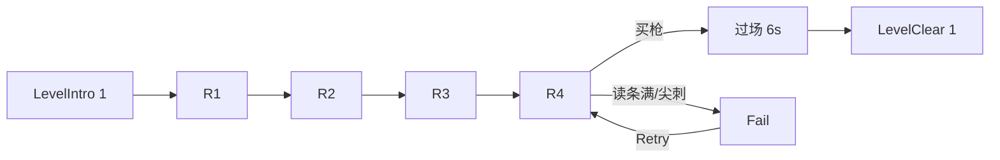

# 第一关 · 笑长（视线激光）

> 模块 M2｜负责人 level-boss｜上游：[00-brief](./00-brief.md)、`02-data-contracts.md`｜实现方：M1 玩法 / M3 过场 / M4 UI｜主角：物化帝（本人）
> 只定义内容与规则，不写实现代码；数值唯一真源 `src/config/balance.ts`。

## 1. 目标与范围

**做什么**：第一关 4 个房间（3 平台跳跃 + 1 Boss 礼堂）的布局、坐标与代码生成美术方案；笑长双眼视线激光（扫射轨迹、0.8s 预警、眨眼安全窗、2.5s 暴露读条、心跳反馈）；礼堂 45s 商店、10 金币购买「子弹枪」、气泡、NPC 夺枪击毙 Boss 的 6s 过场时序与事件契约；通关结算与「子弹枪（潮的馈赠）」；逐字文案、边界、验收、扩展。

**不做什么**：不写代码、不选型、不重复定义全局手感数值（引 brief §5）；商店/结算面板排版归 M4，BGM/镜头/慢动作曲线归 M3；不提供音频文件，只引用 `sfx.*` 逻辑 ID；NPC 完整台词归 M3。

**三条硬标准**：① 认知负担逐房间 +1，每个新机制首次出现都有可复现的安全解法；② 「金币→商店→买枪→夺枪→通关」单线不卡死；③ 过场纯演出，6s 内不用操作、不会失败、不掉钱。

## 2. 机制 / 规则

### 2.1 世界与继承规则

| 规则 | 定义 |
|---|---|
| 房间制 | 每屏一个房间，无滚动镜头；进入右缘触发带（x ≥ 920）切下一房间 |
| 本关血量 | 第一关无 HP：尖刺、坠落、暴露读条满，任一即 Fail |
| 检查点 | R1/R2 用入口出生点；R3 有 1 个检查点；R4 有礼堂入口检查点 |
| 重试 | 回本房间检查点；已拾取金币不重生；已出现的商店保持已出现状态 |
| 金币与存档 | 共 14 枚 × 1，全在 R1–R3；礼堂不投放常规金币；只在通关时写 `progress` |

### 2.2 房间布局

网格约定：30 列 × 32 px。平台房只画下半 12 行（上方 5 行天空省略），礼堂画全 17 行；**图是设计网格，数据层用像素矩形（§7.2）**。图例：`#` 地面/墙、`=` 平台、`^` 尖刺（即死）、`o` 金币、`P` 出生点、`C` 检查点、`N` NPC、`E` 笑长之眼、`S` 商店位、`.` 空。

**R1 起跑（无激光，只教手感）**

```text
..............................
..............................
..................o...........
...............=======........
..............................
......o.......................
...======.....................
..............................
....o.................o.......
..=====..............=====....
P...^^^....C.......^^^.....o..
##############################
```

**R2 被看见（单眼 + 老吴 / 食菌）**

```text
..............................
.......E......................
............o.................
.........=======..............
..............................
.....o........................
...======..............o......
..............................
..........o...................
....========...........====...
P...^^^......N.....^^^.bN..o..
##############################
```

**R3 双视（双眼交替 + 小明；右缘出口同时启动商店计时）**

```text
..............................
.....E................E.......
.................o............
..............=======.........
..............................
...o......................o...
..=====................=====..
..............................
.........o....................
......======..................
P..^^^.......C....^^^....N....
##############################
```

**R4 礼堂（双眼 Boss + 三块挂牌掩体 + 商店位）**

```text
.............EEEE.............
...........EEEEEE.............
.............EEEE.............
..............................
..............................
..............................
..............................
..............................
...#####....#####....#####....
..............................
..............................
..............................
..............................
..............................
.............................S
..P..C........................
##############################
```

**实体与坐标表**（坐标为图示网格列,行；像素 = (列×32, (行+5)×32)（R1–R3），礼堂 = (列×32, 行×32)；地面 y=512，NPC 脚底贴地。假生不在第一关——第一关无 HP，假生归第二关 R1（见 21）。）

| 房间 | 实体 | 坐标 / 说明 |
|---|---|---|
| R1 | 出生 / 金币 ×5 | (0,10) / (18,2)(6,5)(4,8)(22,8)(27,10)；尖刺列 4–6、19–21 |
| R2 | 出生 / 眼 E / 老吴 | (0,10) / (7,1) / (13,10)=(416,512)；交互触发「纱魔罗托」增益（L1-11） |
| R2 | 食菌 / 香蕉皮 / 金币 ×5 | 食菌 (24,10)=(768,512)，香蕉皮装饰 (23,10)，无碰撞；金币 (12,2)(5,5)(23,6)(10,8)(27,10) |
| R3 | 出生 / 检查点 C | (0,10) / (13,10)=(416,480)，检查点只存内存 |
| R3 | 双眼 E / 金币 ×4 | (5,1)(22,1) 交替开火 / (17,2)(3,5)(26,5)(9,8) |
| R3 | 小明 N | (25,10)=(800,512)，出口左侧，只有省略号语气泡，无碰撞无交互（台词不归本文） |
| R4 | 出生 / 检查点 C | (2,15) / (5,15)，C 在左侧挂牌阴影内，安全 |
| R4 | 笑长双眼 / 挂牌 ×3 | 像素中心 (432,64)、(512,64) / 列 3–7、12–16、21–25，行 8；挂牌挡光束，下方为阴影安全区 |
| R4 | 商店位 S | (27,14)，45s 到期升起，详见 2.4 |

### 2.3 视线激光

- **眼与光束**：每眼一条竖直光束，从瞳孔延伸到地面；判定宽 6px、视觉宽 10px。光束碰到挂牌在挂牌顶面截断，下方无判定（阴影区）。第一关被照只涨读条，不直接死。
- **预警与扫射**：每轮攻击先 0.8s 预警（G4）——瞳孔变红、收缩，地面出现 1px 落点细线，`sfx.warning` 低鸣，预警期无判定；预警后开火，光束按模式轨迹横移（P1/P2）或锁定停留（P3）。
- **眨眼安全窗**：每 4s 闭眼 1.2s（G4）。闭眼瞬间光束熄灭、眼睛画成横线，Boss 状态机冻结、读条按 3× 回落。眨眼与 3.6s 攻击轮错相，会随机打断扫射——玩家的免费横穿窗口。
- **暴露读条**：碰撞盒与光束重叠 +1.0/s；离开后 3× 回落（G2）；≥50%（G）时四角暗角呼吸 + 心跳音每 0.5s；满（G1）立即 `game:player-died{cause:'gaze'}` → `game:fail{reason:'gaze'}`。挂牌阴影内不累积，阴影边界以挂牌左右边缘为准。

| 模式 | 出现轮次 | 轨迹 | 安全解法 |
|---|---|---|---|
| P1 单眼横扫 | 每 4 轮的第 1、2 轮 | 右眼 x=160→800 匀速扫（1.8s） | 先在左侧等它扫过，跟在光束背后走 |
| P2 双眼交叉 | 第 3 轮 | 左右眼反向对扫，各 300 px/s | 光束间空档先宽后窄，贴着空档横移 |
| P3 凝视锁定 | 第 4 轮 | 预警期瞳孔追踪玩家 x（240 px/s），锁死后停留 1.2s | 预警期持续横移，或进挂牌阴影 |

### 2.4 商店

- **时机**：计时起点取「进入 R3」与「进入 R4」中较早者（G3，45s）。到期在礼堂 → 原地升起；到期还在 R3 → 进入礼堂后 1.0s 播出现动画（不重复等）。
- **位置与发光**：礼堂右下 (27,14)，底座 64×48 靠右墙；出现时金色圆环 1.2s 一周期脉动 + `!` 气泡 + `sfx.shop` + 0.4s 升起，未购买期间一直脉动。
- **靠近交互**：grounded 且距离 ≤56px（G6）→ 交互环亮起、头顶「E」/触屏按钮；按下进入 Shop 并发 `game:shop-opened{shopId:'hall_shop'}`。
- **面板**：标题「小卖部（快闪）」、商品「子弹枪」、价格「10 金币」、当前金币、按钮「购买」「离开」；不足时置灰并显示「还差 {n} 金币」。面板打开即冻结世界（物理、激光判定、读条、45s 计时全部暂停），关闭后 0.3s 输入保护；购买 → 扣 10 金币 → `game:shop-purchased` → 立即进入 2.5 过场。
- **不买 / 兜底**：不强制，商店一直开，60s 未购买触发一次不耐烦（L1-10）与嘲讽；商店出现瞬间若 coins<10，笑长撒币补到 10（L1-09，记 `borrowed`），撒完才可交互。重试后商店立即存在，不再等 45s。

### 2.5 购买过场

总 6.0s（G7），全程 Cutscene：输入封锁、玩家无敌、激光熄灭、读条清零、Boss 冻结。时间轴 §3.2，事件 §7.1。镜头/慢动作/白闪由 M3 实现，本文只给触发时刻与建议参数（§5.2）。过场按 31 的规则可跳过：0.3s 保护期后任意输入跳过、首看也可跳、跳过只快进时间轴不改状态迁移；低帧按真实时间推进不追帧；结束后进入 `LevelClear(1)`。

### 2.6 难度曲线（整关 3–5 分钟；首次通关死亡 5–10 次属正常）

| 房间 | 新元素 | 教学点 | 预计用时 | 预期死亡 |
|---|---|---|---|---|
| R1 起跑 | 跳跃/土狼时间/尖刺/金币 | 移动与跳跃手感 | 35–50s | 0–2 |
| R2 被看见 | 预警、扫射、眨眼、读条 | 「看预警、等眨眼」 | 45–70s | 1–3 |
| R3 双视 | 双眼轮换、小明在出口旁 | 用走位躲交叉火力 | 60–90s | 2–4 |
| R4 礼堂 | P1/P2/P3、挂牌掩体、商店 | 综合复习 + 买不买决策 | 60–120s | 2–5 |

## 3. 数值与参数表

全局参数直接引用 brief §5、本文不重复取值：G1 视线暴露阈值、G2 暴露衰减、G3 商店出现时间、G4 预警与眨眼窗、G5 商店价格、G6 交互半径、G7 过场总时长、G8 角色手感、G9 金币投放总量。

### 3.1 本关局部参数

| ID | 参数名 | 默认值 | 单位 | 调参影响 |
|---|---|---|---|---|
| L1-01 | 光束判定宽 / 视觉宽 | 6 / 10 | px | 判定越小越宽容；>10 走位容错骤降 |
| L1-02 | 单眼横扫行程 / 速度 | 640（x 160→800）/ 340 | px, px/s | >420 时手机端难跟 |
| L1-03 | 双眼交叉速度 | 300 | px/s | 决定空档流转速度 |
| L1-04 | 凝视追踪速度 / 锁定停留 | 240 / 1.2 | px/s, s | 追踪小于跑速时「跑就能甩开」 |
| L1-05 | 攻击轮周期 / 眨眼相位 | 3.6（0.8 预警 + 1.8 扫射 + 1.0 收束）；每 4.0s 末闭眼 1.2s | s | 周期调小 = 更密；错相眨眼制造随机打断 |
| L1-06 | 挂牌掩体数 | 3 | 块 | 减到 1 块时礼堂接近无掩体 |
| L1-07 | 读条 UI / 心跳间隔 | 顶部中央 240×10 / 0.5 | px, s | 位置必须在双眼下方，不遮眼 |
| L1-08 | 商店 R3 到期延迟 / 关面板保护 | 1.0 / 0.3 | s | 进礼堂后多快看到商店；关面板后短暂不吃输入 |
| L1-09 | 撒币动画时长 / 借币阈值 | 1.0 / coins<10 补到 10 | s, 枚 | 兜底流程总时长；防卡死保险丝 |
| L1-10 | 不耐烦触发 / 加速 | 未购买 60s；每轮 −10%，下限 2.4s | s | 软催促，不改失败规则 |
| L1-11 | 老吴「纱魔罗托」增益 | 视线读条增速 ×0.6，持续 25s，冷却 60s，重复触发刷新 | 倍率, s | 冷却越短越宽容；倍率 >1 会变成惩罚 |

### 3.2 过场时间轴（总 6.0s）

| 时间 | 画面/动作 | 事件 |
|---|---|---|
| 0.00 | 枪交付到物化帝手上（同帧）；激光全熄、读条清零、玩家无敌，输入封锁至 6.00 | `game:cutscene-start{id:'l1_gun_gag'}` `game:shop-purchased` |
| 0.00–2.20 | 笑长眯眼，头顶气泡 2.2s（逐字 §5.5） | — |
| 2.20–2.60 | 潮（过场限定、无台词、面罩剪影）从右缘冲入夺枪（0.4s），物化帝头顶「？」 | — |
| 2.60–3.80 | 潮抬手一枪：2.75 枪响，2.90 命中（白闪 0.08s、慢动作 0.35s、震屏） | 2.90 `game:boss-defeated{bossId:'xiaochang',by:'chao'}` |
| 3.80–5.30 | 笑长连人带椅滑倒（1.5s），潮把枪抛回物化帝（枪即道具本体），眼睛变 X，激光器熄灭 | — |
| 5.30–6.00 | 结算过渡（0.7s）出现「通关」 | 5.30 `game:item-acquired{itemId:'bullet_gun',displayName:'子弹枪（潮的馈赠）'}`；6.00 `game:cutscene-end` `game:level-complete{level:1}` |

金币投放（共 G9）：R1 5 枚、R2 5 枚、R3 4 枚、R4 0 枚；买枪后预期剩 4 枚，兜底借币只在漏捡 >4 枚时触发。

## 4. 流程 / 状态机



| Boss 状态 | 迁移条件 | 下一状态 | 副作用 |
|---|---|---|---|
| IDLE 待机 | 0.4s | TELEGRAPH 预警 | 按模式序列选模式 |
| TELEGRAPH | 0.8s | SWEEP 扫射 | 建立光束判定，`sfx.laser` |
| SWEEP | 1.8s | RECOVER 收束 | 光束熄灭 |
| RECOVER | 1.0s | IDLE | 轮次 +1，4 轮一循环 |
| 任意 → BLINK | 眨眼计时到（每 4s），持续 1.2s 后回原状态按剩余时间继续 | BLINK | 熄光束、冻结计时、读条 3× 回落 |
| 任意 | 读条满 / 购买成功 | Fail / Cutscene | `game:player-died{cause:'gaze'}` / 清屏无敌锁输入 |

| 商店/过场状态 | 进入条件 | 允许操作 | 退出 |
|---|---|---|---|
| Playing | 默认 | 全部 | 靠近 S 交互 → Shop |
| Shop | 距离 ≤56 且 grounded | 面板点击；世界冻结（物理/激光/读条/45s 计时暂停） | 「离开」→Playing（0.3s 输入保护）；购买→Cutscene |
| Cutscene | 购买成功 | 无 | 6.0s 后 LevelClear(1) |
| Fail | 读条满/尖刺/坠落 | 重试、回标题 | 重试 → 本房间检查点 |

## 5. 交互与表现

### 5.1 操作与即时反馈

PC：A/D 或 ←/→ 移动，Space/W/↑ 跳跃，E 交互，鼠标点面板；移动端：左半屏摇杆 + 右下跳跃 + 靠近后出现的交互按钮。跳跃 `sfx.jump`、落地 `sfx.land`、购买 `sfx.purchase`，交互环变亮并给 0.1s 按下态。

### 5.2 镜头与动效契约（交 M3/M4）

| 触发点 | 建议表现 | 参数契约 |
|---|---|---|
| 进入礼堂 | 0.8s 轻推镜到双眼 | `camera.focus('boss_eyes', zoom 1.08, 0.8s)` |
| 激光预警 | 瞳孔变红 + 落点细线 | #FF4D4D，线宽 1px |
| 读条过半 / 读条满 | 四角暗角呼吸 + 心跳 / 眼睛特写 0.6s 后 Fail | 暗角 α 0→0.4，周期 0.5s；Fail 面板不早于 0.6s |
| 命中帧 t=2.90 | 白闪 0.08s + 慢动作 0.35s + 震屏 4px/0.2s | `timeScale 0.25 for 0.35s`，仅命中帧 |
| 减少动效 | 关震屏、白闪改 0.15α、取消慢动作；倒地全景不切镜 | 预警、眨眼、读条必须保留 |

### 5.3 音效使用

`sfx.jump` `sfx.land` `sfx.coin` `sfx.laser` `sfx.warning` `sfx.shop` `sfx.purchase` `sfx.gunshot` `sfx.buff` `sfx.dialogue` `sfx.fail`；`bgm.level1`（进 R1）、`bgm.boss1`（进 R4）。全部逻辑 ID 缺失时静默并只 warn 一次。

### 5.4 美术表现（代码生成扁平矢量，已确认）

统一色板：墨黑 `#1F2430`（描边/文字）、纸白 `#F4F1E8`（底）、物化帝蓝 `#4A90D9`、笑长紫 `#6C5CE7`、校徽金 `#F2C94C`（金币/商店光）、激光红 `#FF4D4D`、尖刺红 `#EB5757`、地面绿 `#3E4A3D`、平台暖灰 `#9B8B6E`。绘制规范：2px 墨黑描边（随 DPR 缩放）、扁平色块为主、仅光晕/背景用线性渐变；基本形只用圆角矩形、圆、多边形；眼睛/枪/光束为独立节点（便于单独旋转、变色、发光）；emoji 仅 UI 点缀。

| 元素 | 图形构成（KAPLAY 图形 API） | 资源槽 |
|---|---|---|
| 天空 / 礼堂背景 | 天空竖直渐变（浅蓝→纸白）+ 3 朵圆角矩形云；礼堂深红幕布 `#7A2E2E` + 金色流苏圆点 + 居中校徽圆 | `art/bg/hall` |
| 地面 / 平台 | 32px 圆角方块拼接；地面主体地面绿 + 顶部 2px 亮边；平台 3 格宽圆角矩形 + 顶面 4px 暖灰亮边 | `art/ground` `art/platform` |
| 尖刺 | 底边 32×8 矩形 + 3 个 45° 三角（`drawPoly`），尖刺红 + 墨黑描边 + 尖顶 2px 白色高光 | `art/spike` |
| 金币 / 检查点 | 20px 圆 + 内圈 14px 圆 + 中心「¥」，校徽金，循环 `scaleX 1→0.3→1`；旗杆 4×48 + 16×12 三角旗，未激活灰、触碰后变金闪 0.3s | `art/coin` `art/checkpoint` |
| 笑长 | 座椅 96×48 圆角矩形 + 靠背；身体 120×160 紫色梯形；头 64×64 圆角方 + 礼帽（矩形 + 横条）；两眼各 24×18 白椭圆 + 16px 黑瞳（预警变红、虹膜收缩）；眨眼替换成 2px 横线 | `art/boss1`（子节点 eyes/hat/seat） |
| 激光光束 | 10px 竖条 + 6px 外发光（α 0.25），激光红；预警期改 1px 细线 | `art/beam` |
| 挂牌掩体 | 5×1 格圆角矩形，棕 `#5C4033` + 金边 + 顶部 `drawText`「校训」 | `art/plaque` |
| 商店底座 | 课桌：64×48 桌面 + 4 条腿 + 桌面亮边；金色双层圆环脉动 + 头顶 `!` 气泡 | `art/shop/pedestal` |
| 子弹枪 | 16×10 枪身（枪灰 `#6E7B8B`）+ 8×4 枪管 + 4×6 握把，金色描边（呼应「潮的馈赠」） | `art/item/bullet_gun` |
| 物化帝 | 碰撞盒 20×28，视觉 24×34：圆角矩形身体物化帝蓝 + 圆头肤色 + 3px 呆毛 + 2px 墨边；持枪时右手多一个枪块 | `art/player` |

### 5.5 逐字文案

| 位置 | 逐字文案 | 时长/条件 |
|---|---|---|
| 章节字幕 / 检查点 | 第一节课 · 跑 ／ 第二节课 · 抬头 ／ 第三节课 · 别往上看 ／ 礼堂 · 笑长在看你 ／ 检查点 · 记住了 | 每房进入 1.5s；检查点 1.0s |
| 进入礼堂 | 抬头。 | 笑长气泡 1.6s |
| NPC 台词（引 brief §8，M3 定稿） | 老吴「纱魔罗托」；食菌「非洲怎么可能有香蕉呢…」；小明只给省略号语气泡；潮在过场无台词，只做夺枪/开枪/抛枪动作 | 交互/靠近时；小明不写台词 |
| 购买成功（t=0–2.2） | 你这玩意能大四人你知道不 | 笑长气泡 2.2s，必须逐字 |
| 商店出现 / 面板 | 校长小卖部开张了 ／ 小卖部（快闪）／子弹枪／10 金币／购买／离开 | 提示 2.0s；面板常驻 |
| 金币不足 | 还差 {n} 金币 | 按钮置灰时 |
| 借币撒钱 / 60s 未购买 | 穷成这样，校长赏你的。 ／ 你搁这陪我唠嗑呢？ | 1.6s；2.0s 仅一次 |
| Fail 副文案 | 你被笑长看穿了。 | 仅 cause='gaze' |
| 结算 | 通关！／获得 · 子弹枪（潮的馈赠）／金币 {n} · 用时 {mm:ss} · 死亡 {d} 次 | 结算面板 |
| 重试按钮 | 重试 | Fail 面板 |

## 6. 边界与异常

| 场景 | 规则 |
|---|---|
| 读条 2.49s 停下 | 未满不死；按 3× 回落；允许在 50% 以上继续冒险 |
| 眨眼瞬间被照 | 闭眼帧立即移除光束判定并停止累积，不会「闭眼还被打」 |
| 购买前一刻被击中 | 同帧先判 Fail、不进入 Shop；读条 2.4s 时仍允许购买，成功帧清零并无敌 |
| 故意不买 / 金币不足 | 不强制，60s 后加速 + 一次嘲讽；正常路径金币足够，异常下置灰 + 提示 |
| 漏捡到 <10 枚 / 到期还在 R3 | 商店出现瞬间借币补到 10（撒币 1.0s，记 `borrowed`）；到期在 R3 则进礼堂后 1.0s 播出现 |
| 过场低帧 / 切后台 / 触控多点 / 失焦 | 按真实时间推进不追帧；切后台暂停；移动 + 跳跃 + 交互可同时按，面板优先吃点击，失焦自动暂停 |
| 无音频 / 减少动效 / 重试坠落 | 静默 + 仅 warn 一次；减少动效关震屏/慢动作但保留预警与读条；重试先回检查点静止再解锁 0.2s |

## 7. 与其他模块的接口

### 7.1 事件

| 方向 | 事件 | 载荷 | 时机 |
|---|---|---|---|
| 发出 | `game:room-enter` | `{level:1, room:'r1'..'r4', index}` | 切房完成帧 |
| 发出 | `game:boss-phase` / `game:boss-defeated` | `{bossId:'xiaochang', phase:'watch'\|'blink'}` / `{bossId:'xiaochang', by:'chao'}` | 礼堂开场/眨眼切换 / 过场 t=2.90 |
| 发出 | `game:cutscene-start` / `game:cutscene-end` | `{id:'l1_gun_gag'}` | t=0 / t=6.00 |
| 发出 | `game:shop-opened` / `game:shop-purchased` | `{shopId:'hall_shop', items:['bullet_gun']}` / `{itemId:'bullet_gun', price:10, coinsAfter, borrowed}` | 交互成功 / 点击购买帧 |
| 发出 | `game:item-acquired` | `{itemId:'bullet_gun', displayName:'子弹枪（潮的馈赠）'}` | 过场 t=5.30 |
| 发出 | `game:coin-changed` / `game:player-died` | `{delta, coins, reason:'pickup'\|'purchase'\|'loan'}` / `{cause:'gaze'\|'spike'\|'fall'}` | 每次变动 / 死亡帧 |
| 发出 | `game:fail` / `game:level-complete` | `{level:1, reason}` / `{level:1, coins, timeMs, deaths, borrowed}` | 死亡帧 / t=6.00 |
| 接收 | `game:level-start` / `game:retry` / `game:dialogue-end` | `{level:1, fromCheckpoint?}` / `{level:1, room}` / `{npcId}` | M0/M1 / Fail 面板 / NPC 气泡结束 |

### 7.2 内容数据结构约定（建议，最终以 `02-data-contracts.md` 为准）

```jsonc
// LevelDef：房间顺序 + 道具定义
{ "id": "level1", "rooms": ["r1","r2","r3","r4"],
  "items": [{ "id": "bullet_gun", "displayName": "子弹枪（潮的馈赠）" }] }
// RoomDef：像素矩形布局 + 实体 + Boss 模式；tilemap 仅作设计标注
{ "id": "r4", "spawn": [64,480], "checkpoint": [176,480], "nextTriggerX": 920,
  "solids": [[0,512,960,32]], "platforms": [[96,256,160,32]],
  "entities": [{ "type": "boss", "id": "xiaochang", "eyes": [[432,64],[512,64]] },
               { "type": "shop", "id": "hall_shop", "at": [864,464] }],
  "boss": { "patterns": ["P1","P2","P3"], "roundSeconds": 3.6, "order": [0,0,1,2] } }
```

### 7.3 资源槽与依赖文件

资源槽见 §5.4；夺枪 NPC 潮用 `art/npc/chao`（仅过场出现，不进常规房间）。依赖文件：`src/content/levels/level1.ts`、`src/content/bosses/xiaochang.ts`、`src/content/items.ts`、`src/config/balance.ts`；`src/scenes/*` 属 M1/M3。

## 8. 扩展点

| 想加的东西 | 做法 | 改核心代码？ |
|---|---|---|
| 加一个平台房 | `LevelDef.rooms` 插入新 RoomDef（solids/platforms/entities），出口触发带指向下一个 id | 否 |
| 加激光模式 / 换眼位眼数 | 新增 pattern 数据（type/轨迹/速度/停留）加入 `boss.patterns` 与 `order`；改 `eyes` 数组与挂牌，判定按「每眼一条光束」通用 | 否 |
| 加商品 / 改金币布局 | `shop.items` 追加 `{itemId, price}`；只改房间数据里的金币与坐标 | 否 |
| 加过场 / 换美术 | 新增 cutscene 数据（时间轴 + 事件点）由 M3 通用播放器读；替换 §5.4 资源槽 | 否（过场需播放器支持） |

## 9. 验收标准

- [ ] 进 R1 出生点正确，右缘触发进入 R2，四房间顺序不可跳过；尖刺碰到立即 Fail 并播 `sfx.fail`。
- [ ] R2/R3/R4 激光都有 0.8s 可见预警且无判定；扫射轨迹与 P1/P2/P3 表一致，P3 预警期瞳孔追踪玩家。
- [ ] 每 4s 出现 1.2s 眨眼窗，闭眼瞬间光束与判定同时消失。
- [ ] 挂牌阴影内读条不涨；被照上涨、离开后 3× 回落；满 2.5s 必 Fail，Fail 副文案为「你被笑长看穿了。」。
- [ ] 重试回检查点，已拾取金币不重生，商店出现状态保留；14 枚金币正确计入 `game:coin-changed`。
- [ ] 45s（或 R3 提前计时）后商店出现在 (27,14)，有脉动光环与升起动画。
- [ ] 距离 ≤56px 且有交互提示才能开店；面板打开即冻结世界（激光/读条/45s 计时暂停），关闭后 0.3s 保护。
- [ ] 金币 ≥10 可购买，扣 10 枚后进入 6.0s 过场。
- [ ] 笑长气泡逐字「你这玩意能大四人你知道不」，持续 2.2s。
- [ ] 过场期间输入封锁、无敌、激光熄灭、读条清零；0.3s 后可按跳过且不改状态迁移；潮夺枪 + 一枪击毙并把枪抛回主角，`game:boss-defeated` 在命中帧发出。
- [ ] 结算显示「获得 · 子弹枪（潮的馈赠）」，存档含 `bullet_gun`，第二关可直接用。
- [ ] 金币不足分支置灰 + 「还差 {n} 金币」；漏捡必触发借币兜底。
- [ ] 故意不买 60s 出现一次加速与嘲讽；老吴增益按 §3.1 L1-11 生效（×0.6 / 25s / 冷却 60s）。
- [ ] 全部视觉为代码生成扁平矢量（§5.4），无外部图片，`art/*` 槽可整体替换。
- [ ] 减少动效模式关震屏/慢动作；无音频时静默 + 仅 warn 一次；触控多点不冲突。

## 10. 风险与待确认

1. **借币兜底**：brief「14 枚保底」之外我加的安全丝。若认为「漏捡就该重打」，可删 L1-09 并改为 Fail 提示回去捡。
2. **45s「取先到」解释**：本文按「进 R3 即计时；到期在礼堂就升起、到期时还在 R3 则进礼堂后 1s 播出现」。若本意是「进礼堂后再等 45s」，需一句话确认。
3. **礼堂金币为 0**：若希望等待期「边躲边捡」，加 2 枚会使总数变 16、与 G9 冲突，需 Lead 同步改 brief。
4. **R2/R3 是简化版视线**（单眼/交替单眼），R4 才双眼完整版。若要求三房统一双眼，需重做难度曲线。
5. **眼位像素**：眼位 (432/512,64) 与挂牌行 8 按 960×540 计算，若 HUD 更高需整体下移 16–24px；商店面板请 M4 用下半屏半透明，别盖住读条。

## 11. 与其他模块的接口汇总

| 对方 | 给我什么 | 我给什么 |
|---|---|---|
| M0 Lead | 全局数值、事件名、schema、存档字段、美术方向 | 房间/Boss 数据字段需求、验收标准、逐字文案 |
| M1 gameplay-systems | 角色控制、碰撞、平台、金币拾取、Fail/Retry 框架、射击通用实现 | 房间像素布局、激光判定与读条规则、商店交互规则 |
| M3 narrative-content | NPC 台词与气泡、过场播放器、镜头/慢动作/BGM | 过场时间轴与事件点、Boss 逐字气泡、NPC 效果契约 |
| M4 ui-ux | 商店/结算/Fail 面板、读条暗角、触控按钮 | 文案、显示字段、状态流程、色板与矢量规范 |
| M5 engine-impl | 资源加载、事件总线、`balance.ts` | 参数 ID 清单、资源槽清单、房间数据样例 |
