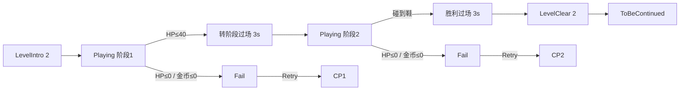

# 第二关 · 消耗战（第二关 Boss）

> 模块 M2｜负责人 level-boss｜上游：[00-brief](./00-brief.md)、`02-data-contracts.md`、[30-npc-dialogue](./30-npc-dialogue.md)｜实现方：M1 玩法 / M3 过场 / M4 UI｜主角：物化帝（本人）
> 只定义内容与规则，不写实现代码；数值唯一真源 `src/config/balance.ts`。

## 1. 目标与范围

**做什么**：单房间竞技场的布局（掩体、Boss、鞋、假生）与代码生成美术方案；Boss 两阶段状态机与 6 种可躲攻击（四连追踪弹、点名粉笔雨、地面冲击波、香蕉皮陷阱、巨型冲击波、巨足踩踏）；子弹枪的伤害/冷却/碰撞；-1 HP 且 -5000 金币的受击、Boss 受击掉 2500 金币的拾取；血条 + 金币条双失败；≤40 HP 巨大化转阶段（子弹失效/刮痧）；碰鞋胜利的判定框与喜剧逻辑；通关「未完待续」；阶段检查点重试。

**不做什么**：不写代码、不选型、不重复全局数值（引 brief §5）；HUD 排版归 M4，镜头/慢动作/过场播放归 M3；不提供音频文件，只引用 `sfx.*`；Boss 正式名未给，全文用「第二关 Boss」，UI 显示「BOSS」。

**三条硬标准**：① 阶段 1 每种攻击都有「看得见的预警 + 明确躲法」，无随机必死；② 金币就是第二条命，玩家能通过持续命中共钱；③ 失败只回阶段检查点，不整关重来。

## 2. 机制 / 规则

### 2.1 世界与失败规则

| 规则 | 定义 |
|---|---|
| 房间 | 单房间竞技场（30×17 网格，960×540），无滚动、无出口，打赢才结束 |
| 血量 / 金币 | HP（心形，G）与金币（数值条）双资源；受击同时 -1 HP、-5000 金币（G） |
| 失败 | HP ≤ 0 **或** 金币 ≤ 0，任一即 Fail；同帧都归零时文案取 HP |
| 失败音效 | `sfx.fail`（用户稍后提供，缺失静默 + warn 一次） |
| 子弹枪 | 进关从存档 `progress.items` 读取；若缺失（调试/异常存档）自动补发并 `game:item-acquired` fallback |
| 无敌帧 | 受击后 1.2s 无敌 + 闪烁，期间不再结算受击 |
| 重试 | 回到阶段检查点（见 2.8），不整关重来、不扣存档 |

### 2.2 竞技场布局

网格 30 列 × 32 px，17 行；行 16 = 地面 y 512（本关唯一房间，即 30 触发矩阵的 L2/R1）。图例：`#` 地面/讲台掩体、`B` Boss、`P` 出生点、`N` 假生、`.` 空。

```text
..............................
..............................
..............................
..............................
..............................
..............................
..............................
..............................
.......................BBBBB..
.......................BBBBB..
.......................BBBBB..
.......................BBBBB..
.......................BBBBB..
.......................BBBBB..
.......###.....###.....BBBBB..
..P..N.###.....###.....BBBBB..
##############################
```

**区域与判定框**

| 区域 | 像素范围 | 说明 |
|---|---|---|
| 玩家出生 | (64,480)（脚底 y=512） | 重试回此处；x 64–160 为安全起手区 |
| 假生 N | (160,512)，非必经 | 地面 y=512，脚底贴地（与 30 §2.6 矩阵一致）；交互一次性，见 2.4 与 30 §2.5 |
| 讲台掩体 A / B | A x224–320，B x480–576，y448–512（96×64） | 挡住玩家子弹与 Boss 追踪弹；可跳上顶部 |
| 中庭 | x320–480 | 开阔走位区，粉笔雨与香蕉皮主要落点 |
| Boss 受击盒 | x736–896，y256–512（160×256） | 只有阶段 1 可受伤 |
| 鞋判定框 | x640–832，y448–512（192×64） | **仅阶段 2 生效**，碰到即胜 |
| 巨型 Boss 视觉 | x480–960，y0–540 | 纯视觉，不参与碰撞；巨大化时把两座讲台踩碎 |
| HUD | 顶部 0–64 | 左：5 心；中：BOSS 血条；右：金币数值条 |

### 2.3 攻击模式（阶段 1）

Boss 循环出招：A1 → A2 → A3 → A4，每招之间 1.2s 收招硬直；连续两轮不重复同一招。所有攻击都能被掩体/跳跃/走位处理，不做无预警弹幕。

> 2026-11-23 用户要求提高 Boss 难度：收招硬直 1.6→1.2s；A1 追踪弹 3→4 发；A2 粉笔雨 5→6 根。数值集中在 `balance.ts`，可随时回调。

| ID | 模式 | 预警 | 频率/间隔 | 速度 | 判定框 | 存活 | 躲法 |
|---|---|---|---|---|---|---|---|
| A1 | 四连追踪弹 | 0.6s（抬手 + 粉笔灰） | 4 发，发间 0.25s | 260 px/s，转向 120°/s | 18×18 | 6s | 躲到讲台后（撞掩体销毁）或绕大圈 |
| A2 | 点名粉笔雨 | 0.7s（地面 6 个红圈） | 6 根，间隔 0.12s | 下落 700 px/s | 16×24 | 落地即碎 | 看到红圈后横移，别停原地 |
| A3 | 地面冲击波 | 0.5s（跺脚 + 尘土） | 每次 1 道 | 380 px/s 向左 | 32×40（y472–512） | 出屏即消 | 跳跃；站在讲台顶天然安全 |
| A4 | 香蕉皮陷阱 | 0.4s（地面阴影） | 3 个/次，间距 ≥120 | 静止 | 28×14 | 6s | 跳过 / 子弹打掉；踩到滑倒 0.9s 失控（不直接扣血） |

**阶段 2（巨大化）攻击**

| ID | 模式 | 预警 | 频率 | 速度 | 判定框 | 躲法 |
|---|---|---|---|---|---|---|
| A5 | 巨型冲击波 | 0.6s（脚下扬尘） | 每 2s 一道（G） | 420 px/s 向左 | 48×56（y456–512） | 必须跳；掩体已碎，只能跳 |
| A6 | 巨足踩踏 | 0.8s（脚下阴影 + 抬脚） | 每 3s，与 A5 错开 | 预警时锁定落点（之后不再追玩家） | 96×64（y448–512），落地停留 0.2s | 预警期离开阴影；跳起可躲，但落地要防冲击波 |

### 2.4 玩家输出与拾取

- **射击**：PC `J`/鼠标左键，移动端右下射击键（按住连发）；冷却 0.25s（G），无弹药限制。
- **子弹**：速度 700（G）、伤害 4（G）、判定 10×6、存活 1.2s；水平飞行，撞讲台掩体或 Boss 受击盒即消失；不摧毁 Boss 弹幕（只有香蕉皮可被子弹清除）。
- **命中结算**：Boss 阶段 1 每发 −4 HP；**每累计 3 次有效命中**在命中点掉落 1 枚「2500 金币」（G，`bossHitsPerCoin=3`，与 02/10 一致）；场上金币最多 5 枚，超出时最早一枚消失；金币存活 8s，拾取判定半径 28px、磁吸半径 64px、磁吸速度 300 px/s。
- **刮痧**：阶段 2 子弹伤害记为 0，命中飘字「-0」，每累计 3 发额外飘一次「刮痧」；不给金币掉落。
- **假生**：靠近可交互，一次性触发 -1 HP（**不可致死**，HP=1 时保持 1）且不扣金币；之后只放台词。属非必经陷阱，位置 (160,512)。

### 2.5 转阶段（≤40 HP）

Boss HP 被扣到 ≤40（G）时立即进入转阶段过场，历时 3.0s：冻结 0.4s → Boss 气泡「你打不动的。」（0.8s）→ 巨大化 1.2s（镜头拉远、震屏、两座讲台被踩碎）→ 站定 0.6s。过场期间：输入封锁、玩家无敌、清空场上 Boss 弹幕与地面香蕉皮、Boss 不再受伤、`game:boss-phase{phase:'p2_giant'}` 在巨大化开始时发出。过场按 31 的规则可跳过：0.3s 保护期后任意输入跳过、首看可跳、跳过只快进时间轴不改状态迁移。

### 2.6 碰鞋胜利

- 阶段 2 的 Boss 大到填满右半屏，子弹只飘「-0」；唯一可碰的是它翘在地上的巨大皮鞋。
- **判定框**：x640–832、y448–512（192×64），仅阶段 2 且巨大化过场结束 1.0s 后激活；玩家任意状态（跑/跳/下落）碰到即胜，同帧受击时胜利优先。
- **喜剧逻辑**：校长最怕新买的皮鞋被碰脏——玩家一碰鞋，他慌忙抬脚想护鞋，结果被自己的鞋带绊倒。所以这不是「打赢」而是「碰瓷碰赢」；前一关一本正经的「物理」到这里被一只鞋终结，正好呼应「物化帝」的荒诞。Boss 在阶段 2 距鞋 200px 内会气泡逐字「别碰我鞋！新买的！」（仅一次）。

### 2.7 HUD 与失败判定

- 血条：5 颗心（G），受击碎一颗；≤2 颗心跳动 + 红色暗角。
- 金币条：满格 20000，当前值数字常显；<5000 变红 + 心跳音；≤0 即 Fail。
- BOSS 血条：阶段 1 显示 100→40；阶段 2 锁在 40 并显示锁图标 + 「打不动了」标签。
- 失败顺序：先结算金币拾取（可救命），再判 HP≤0 / 金币≤0；同帧双归零取 HP 文案。

### 2.8 重试与阶段检查点

| 检查点 | 触发 | 快照 |
|---|---|---|
| CP1 | 进关 / 阶段 1 任意失败 | HP 5、金币 15000、Boss 100、位置 (64,480) |
| CP2 | 阶段 2 开场 / 阶段 2 任意失败 | HP = max(3, 转阶段时 HP)、金币 = max(15000, 转阶段时金币)、Boss 40、位置 (64,480) |

阶段 2 重试直接以巨大化状态开场：1.0s 快速入场（不再播 3s 过场），鞋判定同样 1.0s 后激活；清空弹幕与场上金币，给 1.5s 无敌。失败次数计入 `stats.deaths`，不影响存档金币与道具。

## 3. 数值与参数表

全局参数直接引用 brief §5、本文不重复取值：G1 初始血量、G2 初始金币、G3 受击惩罚、G4 金币拾取、G5 Boss 血量、G6 子弹伤害、G7 射击冷却、G8 子弹速度、G9 巨大化阈值、G10 巨型冲击波频率、G11 失败条件。

### 3.1 本关局部参数

| ID | 参数名 | 默认值 | 单位 | 调参影响 |
|---|---|---|---|---|
| L2-01 | Boss 受击盒 / 站位 | 160×256 / (736,256) | px | 变窄更容易打空，变宽更容易命中 |
| L2-02 | 子弹判定 / 存活 | 10×6 / 1.2 | px, s | 存活太短时远距离打不到 |
| L2-03 | 攻击轮间隔 | 1.2 | s | 调小 = 更密，手机端压力大；2026-11-23 难度调参 1.6→1.2 |
| L2-04 | A1 追踪弹速度 / 转向 | 260 / 120 | px/s, °/s | 转向低时可贴脸绕背 |
| L2-05 | A2 粉笔雨落点采样 | 玩家过去 1.5s 内 6 个位置（按时间等距，不是按帧号） | s, 个 | 采样越长越好预判 |
| L2-06 | A3 冲击波速度 / 高度 | 380 / 40 | px/s, px | 高度 >56 时站讲台顶也会被扫到 |
| L2-07 | A4 香蕉皮 数量 / 存活 / 滑倒 | 3 / 6 / 0.9s 滑行 300px | 个, s | 滑倒越久越像惩罚 |
| L2-08 | 转阶段过场 | 3.0（冻结 0.4 + 气泡 0.8 + 变大 1.2 + 站定 0.6） | s | 可跳过，0.3s 保护 |
| L2-09 | A6 踩踏间隔 / 判定 | 3.0 / 96×64 / 同帧顺延 0.35 | s, px, s | 与 A5 错开，避免同帧双杀 |
| L2-10 | 无敌帧 / 受击闪烁 | 1.2 / 0.2 | s | 太短会被连击，太长会无脑 |
| L2-11 | 鞋判定框 / 激活延迟 | 192×64 / 1.0 | px, s | 太早激活会出现「转阶段瞬赢」 |
| L2-12 | 金币上限 / 存活 / 磁吸 | 5 枚 / 8s / 64px | 个, s, px | 上限低时命中收益被吞 |
| L2-13 | 金币条第 1 警戒线 | 5000 | 金币 | 与两次受击等值，制造「再挨一下破产」 |
| L2-14 | CP2 下限补偿 | HP≥3、金币≥15000 | — | 防止低资源快照卡死 |
| L2-15 | 胜利过场 | 3.0（失衡 0.8 + 摔倒 1.2 + 黑场 0.4 + 未完待续 0.6） | s | 可跳过 |
| L2-16 | 失败重试入场保护 | 1.5 | s | 防重试即死 |

## 4. 流程 / 状态机



| Boss 状态 | 迁移条件 | 下一状态 | 副作用 |
|---|---|---|---|
| INTRO 登场 | 1.2s | IDLE | Boss 气泡「听说你带枪了？」 |
| IDLE 待机 | 0.8s | 攻击 A1–A4 | 按循环选下一招 |
| 攻击中 | 招式时长结束 | IDLE | 间隔 1.2s |
| 任意 | Boss HP ≤40 | TRANSITION | 清弹幕、锁输入、`game:boss-phase{p2_giant}` |
| TRANSITION | 3.0s 或跳过 | GIANT_IDLE | 掩体消失、子弹失效、鞋 1.0s 后激活 |
| GIANT_IDLE | 每 2s / 3s | A5 / A6 | 冲击波与踩踏错开 |
| 任意 | 碰鞋 | VICTORY | 清屏、锁输入、`game:boss-defeated` |
| 任意 | HP≤0 / 金币≤0 | Fail | `game:player-died` + `game:fail` |

| 关卡状态 | 进入条件 | 允许操作 | 退出 |
|---|---|---|---|
| Playing | 默认 | 移动、跳跃、射击、交互 | 转阶段 / 胜利 / Fail |
| Cutscene | 转阶段或碰鞋 | 0.3s 后可跳过 | 回到 Playing 或 ToBeContinued |
| Paused | 失焦 / 手动暂停 | 继续、回标题 | 恢复原状态 |
| Fail | HP≤0 或 金币≤0 | 重试、回标题 | → 对应阶段检查点 |

## 5. 交互与表现

### 5.1 操作与即时反馈

PC：A/D 或 ←/→ 移动，Space/W/↑ 跳跃，J 或鼠标左键射击（可长按连发），E 交互；移动端：左半屏摇杆 + 右下跳跃 + 右下射击键（按住连发，受冷却限制）+ 交互按钮。反馈：`sfx.jump` `sfx.land` `sfx.gunshot` `sfx.hurt` `sfx.coin`，受击红闪 0.2s + 震屏，刮痧飘字，金币磁吸有金色拖尾。

### 5.2 镜头与动效契约（交 M3/M4）

| 触发点 | 建议表现 | 参数契约 |
|---|---|---|
| 进关 | 0.8s 推镜到 Boss | `camera.focus('boss2', zoom 1.06, 0.8s)` |
| 转阶段 | 镜头拉远到 0.86 + 震屏 6px/0.4s | 巨大化开始触发，过场结束回 1.0 |
| 碰鞋 | 0.15s 定格 + Boss 脚部特写 0.4s | 慢动作 0.3s（减少动效时取消） |
| 受击 | 红闪 + 震屏 3px/0.15s + 金币数字飘落 | 减少动效时只保留红闪 |
| 胜利 / 失败 | 黑场 0.4s 后出字 | 文案由 M4 排版，本文提供逐字内容 |

### 5.3 美术表现（代码生成扁平矢量，已确认）

沿用第一关色板：墨黑 `#1F2430`（描边/文字）、纸白 `#F4F1E8`（底）、物化帝蓝 `#4A90D9`、校徽金 `#F2C94C`（金币/高光）、激光红 `#FF4D4D`、猩红 `#EB5757`（危险/心）。本关新增：Boss 青 `#2F6F6B`、粉笔白 `#F7F3E7`、鞋黑 `#2B2B33`。2px 墨黑描边、扁平色块、圆角矩形/圆/多边形三种基本形，仅光晕与冲击波用渐变或半透明。

| 元素 | 图形构成（KAPLAY 图形 API） | 资源槽 |
|---|---|---|
| 竞技场背景 | 竖直渐变（浅灰→纸白）+ 黑板矩形（深绿 `#2E4A3E`，顶部 4px 木框）+ 横幅红布条 + 3 个圆点彩灯 | `art/bg/arena` |
| 地面 / 讲台掩体 | 地面 32px 方块拼接；讲台 = 96×64 圆角矩形桌面 + 两条腿，顶面 4px 亮边，被踩碎时裂成 4 块多边形 | `art/arena/desk` |
| 第二关 Boss | 身体 160×256 圆角矩形（Boss 青西服）+ 72 圆头 + 方框眼镜（两条 24×18 矩形 + 鼻梁线）+ 三角领带（校徽金）；抬手 = 手臂矩形旋转；巨大化 = 整体 scale 2.2 + 眼镜白光矩形 | `art/boss2`（子节点 arm/glasses/tie） |
| 皮鞋 | 192×64：鞋头半圆 + 鞋身矩形 + 3 条鞋带短线 + 金扣圆 + 白袜矩形；阶段 2 独立节点，可单独抬起/落地 | `art/boss2/shoe` |
| 四连追踪弹 | 8px 白粉笔头 + 3 个渐隐尾迹圆（粉笔白） | `art/proj/chalk` |
| 粉笔雨 | 地面预警 = 红色空心圆环（α 脉动）；落下的粉笔 = 16×24 竖条 + 尖头 | `art/proj/chalk_rain` |
| 地面冲击波 | 梯形/半圆多段拼接的土黄波浪 + 3 个尘点圆，向左侧移动 | `art/fx/shockwave` |
| 香蕉皮 | 2 条黄色圆弧（`drawPoly` 近似）+ 黑色小点；命中清除时碎成 3 个小三角 | `art/trap/banana` |
| 金币 | 与第一关同款 20px 金圆 + 「¥」；掉落时带抛物线 + 金色拖尾 | `art/coin` |
| 心 / 金币条 | 心 = 两圆 + 三角（猩红）；金币条 = 圆角矩形底 + 金色填充，<5000 变红 | `art/ui/heart` |
| 假生 | 与其他 NPC 同款 24×34 扁平方块人，配色换灰 | `art/npc/jiasheng` |

### 5.4 逐字文案

| 位置 | 逐字文案 | 时长/条件 |
|---|---|---|
| 章节字幕 | 第二关 · 消耗战 | 进入时 1.5s |
| 开局补给 | 文案见 31 §5.6（老吴塞钱）；HUD 金币滚动到 15000 | LevelIntro(2) |
| Boss 登场 | 听说你带枪了？ | 气泡 1.8s |
| 转阶段 | 你打不动的。 | 气泡 0.8s |
| 刮痧飘字 | -0 ／ 刮痧 | 每次命中 / 每 3 发 |
| 靠近鞋 | 别碰我鞋！新买的！ | 气泡 1.6s，阶段 2 仅一次 |
| 碰鞋瞬间 | 哎哎哎—— | 气泡 0.6s（可用音效替代） |
| 假生 | 都这个点了还没死呢 | 交互时，一次性 |
| Fail（HP） | 你倒下了。 | HP≤0 |
| Fail（金币） | 你破产了。 | 金币≤0 |
| HUD | HP ／ 金币 ／ BOSS ／ 打不动了 | 常驻 |
| 胜利 | 未完待续 ／ 第二关 · 完 ／ 死亡 {d} 次 · 用时 {mm:ss} | ToBeContinued 屏 |
| 重试按钮 | 重试 ／ 回到阶段检查点 | Fail 面板 |

## 6. 边界与异常

| 场景 | 规则 |
|---|---|
| 转阶段瞬间玩家位置 | 冻结处理；若玩家已在鞋判定框内，鞋按常规 1.0s 激活、期间把玩家软推到 x=560，不瞬赢 |
| 转阶段瞬间子弹在飞 | 全部清除，不结算伤害与掉落，避免「死前命中」抢阶段 |
| 鞋判定与受击同帧 | 胜利优先，照常发 `game:boss-defeated` |
| 金币拾取与失败同帧 | 先结算拾取再判失败，掉落可救命 |
| 金币将被扣成负数 | 钳制到 0 并 Fail（reason='broke'） |
| HP=1 时交互假生 | 假生不致死：保持 HP=1，不扣金币，只放台词（引 30 §2.5） |
| CP2 快照资源过低 | 按 L2-14 下限补偿 HP≥3、金币≥15000，避免重试死循环 |
| 重试入场 | 清弹幕/香蕉皮/场上金币，给 1.5s 无敌，玩家回 (64,480) |
| 站在讲台上转阶段 | 讲台碎裂，玩家下落 0.3s，不受伤 |
| 香蕉皮与掩体 | 只生成在地面，不生成在讲台顶；滑倒撞到攻击照常受击 |
| 暂停 / 切后台 | 全部冻结（Boss 计时、弹幕速度、金币存活计时）；回前台 0.3s 恢复保护 |
| 低帧 | 弹幕与子弹用连续碰撞（扫掠 AABB），不出现穿模；时间按真实时间推进 |
| 触控多点 / 失焦 | 移动 + 跳跃 + 射击可同时按；失焦自动暂停；射击键按住连发受冷却限制 |
| 无子弹枪 | 进关自动补发 `bullet_gun` 并提示，不卡关 |
| 无音频 / 减少动效 | 静默 + 仅 warn 一次；减少动效关震屏/慢动作，保留全部预警 |

## 7. 与其他模块的接口

### 7.1 事件

| 方向 | 事件 | 载荷 | 时机 |
|---|---|---|---|
| 接收 | `game:level-start` | `{level:2, checkpoint:'cp1'}` | 进入第二关 |
| 发出 | `game:boss-phase` | `{bossId:'boss2', phase:'p1'\|'p2_giant'}` | 登场 / 巨大化开始 |
| 发出 | `game:cutscene-start` / `game:cutscene-end` | `{id:'l2_giant'\|'l2_shoe', skippable:true}` | 转阶段 / 碰鞋 |
| 发出 | `game:boss-defeated` | `{bossId:'boss2', method:'shoe'}` | 碰鞋帧 |
| 发出 | `game:player-damaged` | `{hp, coins, cause:'homing'\|'chalk'\|'wave'\|'banana'\|'stomp'\|'jiasheng'}` | 每次受击 |
| 发出 | `game:coin-changed` | `{delta:+2500\|-5000, coins, reason:'pickup'\|'hit'}` | 命中掉落拾取 / 受击扣款 |
| 发出 | `game:item-acquired` | `{itemId:'bullet_gun', fallback:true}` | 仅缺枪兜底 |
| 发出 | `game:player-died` / `game:fail` | `{cause:'hp'\|'broke'}` / `{level:2, reason}` | HP 或金币归零 |
| 发出 | `game:level-complete` | `{level:2, timeMs, deaths}` | 胜利过场结束 |
| 接收 | `game:retry` | `{level:2, checkpoint:'cp1'\|'cp2'}` | Fail 面板 |
| 接收 | `game:dialogue-end` | `{npcId:'jiasheng'}` | 假生交互结束 |

### 7.2 内容数据结构约定（建议，最终以 `02-data-contracts.md` 为准）

```jsonc
// LevelDef（本关：无出口；checkpoint 快照）
{ "id": "level2", "spawn": [64,480], "items": ["bullet_gun"],
  "checkpoints": { "cp1": { "hp": 5, "coins": 15000, "bossHp": 100 },
                   "cp2": { "hpFloor": 3, "coinsFloor": 15000, "bossHp": 40 } } }
// BossDef：阶段 + 攻击模式引用 pattern 注册表，加招不改引擎
{ "id": "boss2", "hp": 100, "hurtbox": [736,256,160,256],
  "phases": [ { "atHp": 100, "patterns": ["A1","A2","A3","A4"], "gap": 1.2 },
              { "atHp": 40, "patterns": ["A5","A6"], "cutscene": "l2_giant" } ],
  "shoe": [640,448,192,64], "victory": { "type": "touch", "target": "shoe" } }
```

### 7.3 资源槽与依赖文件

资源槽见 §5.3。依赖文件：`src/content/levels/level2.ts`、`src/content/bosses/boss2.ts`、`src/content/items.ts`、`src/config/balance.ts`；`src/scenes/*` 属 M1/M3。

## 8. 扩展点

| 想加的东西 | 做法 | 改核心代码？ |
|---|---|---|
| 加一种攻击 | 在 pattern 注册表新增数据（type/预警/速度/判定/时长），加入某阶段 `patterns` | 否 |
| 加一个 Boss 阶段 | `phases` 追加 `{atHp, patterns, cutscene}`，血条与转阶段由数据驱动 | 否 |
| 换 Boss / 加新 Boss | 新建 BossDef 数据 + 资源槽，关卡引用 id | 否 |
| 调消耗战平衡 | 只改 `balance.ts` 与 checkpoints 快照，不动招式逻辑 | 否 |
| 换美术 | 替换 §5.3 资源槽，逻辑不动 | 否 |

## 9. 验收标准

- [ ] 进关玩家在 (64,480)，地面/讲台/掩体位置与布局图一致，假生在 (160,512)。
- [ ] 假生交互一次：-1 HP、不扣金币、HP=1 时不死，之后只放台词。
- [ ] HP 5 心、金币 15000 正确显示；受击 -1 HP 且 -5000 金币并进入 1.2s 无敌。
- [ ] 阶段 1 四种攻击都有可见预警、可躲避；A1 撞掩体销毁、A3 可跳、A4 可跳过或打掉。
- [ ] 子弹枪伤害 4、冷却 0.25s、速度 700；子弹被讲台挡住、命中 Boss 掉 2500。
- [ ] 金币掉落有上限 5 枚、8s 消失、可磁吸拾取；拾取同帧可避免破产。
- [ ] Boss 扣到 ≤40 HP 触发 3.0s 转阶段；期间锁输入、清弹幕、掩体碎裂。
- [ ] 转阶段后子弹只飘「-0」与「刮痧」且不掉金币；血条锁 40 显示「打不动了」。
- [ ] 阶段 2 巨型冲击波每 2s 一道、踩踏每 3s 一次；鞋判定 1.0s 后激活。
- [ ] 碰鞋即胜，胜利优先于同帧受击；Boss 气泡逐字「别碰我鞋！新买的！」只出一次。
- [ ] HP≤0 或金币≤0 均 Fail 且播 `sfx.fail`；文案分别为「你倒下了。」「你破产了。」。
- [ ] 失败只回 CP1/CP2（资源按下限补偿），不整关重来；重试清弹幕并给 1.5s 无敌。
- [ ] 转阶段与胜利过场 0.3s 后可跳过，跳过不改状态迁移。
- [ ] 通关显示「未完待续」与「第二关 · 完」，死亡/用时统计正确。
- [ ] 全部视觉为代码生成扁平矢量（§5.3），Boss 与皮鞋可整体替换资源槽。
- [ ] 触控移动 + 跳跃 + 射击同时可用；无音频静默且仅 warn 一次；低帧不穿模。

## 10. 风险与待确认

1. **Boss 名称**：brief 未给，全文用「第二关 Boss」占位，UI 只显示「BOSS」；用户给出名称后再补资源槽与血条名。
2. **金币条上限 20000**：已定案（02 `player.maxCoins=20000`），满格显示 20000，掉落溢出不再增长；15000 是开局值，不是上限。
3. **鞋的判定**：本文做成「阶段 2 全程可碰」+1.0s 激活延迟，靠冲击波与踩踏制造 1–2 次跳跃的压力；若实测太短，可加「只在冲击波后 0.6s 开窗口」。
4. **覆盖与体验**：阶段 2 掩体全碎后只剩跳跃，若手机端太难可把 A5 频率从 2s 放宽到 2.5s（会动 G10，需 Lead 改 brief）。
5. **假生扣血**：按 30 §2.5 做成不可致死、不扣金币；若用户希望更凶，可改为「HP>1 时 -1」，仍不致死。
6. **15000 与三次破产**：受击扣 5000 后 15000→10000→5000→0，正好三次破产；金币掉落 2500/次可续。若用户觉得「三次就输」太狠，可把 G3 调到 -4000（需改 brief）。

## 11. 与其他模块的接口汇总

| 对方 | 给我什么 | 我给什么 |
|---|---|---|
| M0 Lead | 全局数值、事件名、schema、存档字段 | Boss 阶段/攻击数据需求、检查点规则、验收标准 |
| M1 gameplay-systems | 角色控制、碰撞、子弹与受击框架、金币拾取、Fail/Retry | 弹幕参数表、判定框、攻击循环、检查点快照 |
| M3 narrative-content | Boss 气泡播放、过场播放器（可跳过）、镜头/BGM | 过场时间轴与事件点、逐字文案、假生效果契约 |
| M4 ui-ux | 心形血条、金币条、BOSS 血条、失败/胜利面板、触控按钮 | 数值与警戒线、状态流程、色板与矢量规范 |
| M5 engine-impl | 资源加载、事件总线、`balance.ts`、pattern 注册表 | 参数 ID 清单、资源槽清单、Boss 数据结构样例 |
