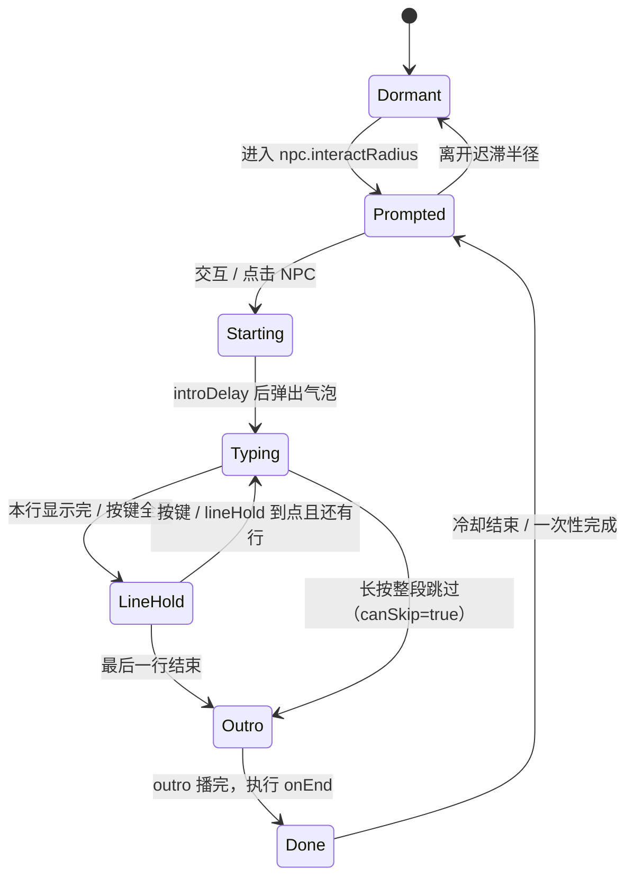

# 30 · NPC 对话系统与角色演出

> 模块 M3 · 叙事 / NPC｜负责人 narrative-content｜上游 `docs/00-brief.md`（§4 事件、§5 数值、§6 音频与存档、§8 梗词表）｜下游 40-ui-ux（气泡样式）、20/21（房间站位）、02-data-contracts（存档字段）
> 本文只定规则、文案与数据契约，不写实现代码；所有数值集中在 §3，其他章节只引用参数名。

## 1. 目标与范围

**做什么**

- 定义四名 NPC（老吴、小明、食菌、假生）的站位、触发条件、重复策略、对话数据与完整演出。
- 定义通用对话状态机：靠近提示 → 交互 → 打字机 → 跳过 → 结束，含输入封锁、逐行推进、整段跳过与回看。
- 定义老吴增益、食菌一次性道具、假生扣血的规则与跨模块接口（不擅自改战斗数值）。
- 给出 `NpcDef` / `DialogueDef` 数据结构与「加 NPC / 加台词行」的扩展点。
- 给出逐字文案（小明通篇无字，方案见 §5.3）、边界异常与可测验收项。

**不做什么**

- 不写引擎代码（`src/systems/dialogue.ts` 等由 engine-impl 实现）；不新增音频逻辑 ID，只用简报 §6 列表。
- 不定气泡视觉样式（圆角、配色、描边归 40-ui-ux），只定字号层级、图层与出现时机。
- 不定 Boss 台词、商店 UI、购买过场、失败画面、未完待续（见 `31-cutscene-and-audio.md`）。
- 不涉及主角设定：主角已确认为**物化帝本人**，本模块只负责他身边的 NPC。

**体验目标**：NPC 是奖励和笑点，不是路障。任何扣血都必须可预期、可规避、不致死。

## 2. 机制与规则

### 2.1 通用对话规则（四名 NPC 共用）

- **触发方式**：`interact`（进范围出提示，按键/点击开始）与 `auto`（进范围自动演出、不锁输入）。小明是 `auto`，其余三人是 `interact`。
- **站位与形象**：NPC 静态固定在房间地面（双脚贴地板）；首版用**扁平矢量程序化绘制**——统一色板 + 2px 深色描边 + 圆形头 / 矩形身体 / 线段四肢 / 汉字或 emoji 点缀，坐标写在内容数据里，不硬编码进房间代码；资源槽保留，后期可整体换手绘。
- **靠近提示**：进入 `npc.interactRadius` 后延迟 `npc.hintDelay` 出现头顶徽标（PC「E」，触控「💬」圆钮，也可直接点 NPC 本体）；提示淡入不发声；离开 `npc.interactRadius × npc.leaveHysteresis` 才消除，防止边缘闪烁。
- **进入对话**：全局状态 `Playing → Dialogue`，发 `game:dialogue-start`；玩家移动/跳跃/射击/交互锁定，Boss 与关卡攻击计时暂停，非必要 HUD 淡出。
- **打字机**：逐字显示，基础节奏 `dialogue.charInterval`；句读符号额外停顿 `dialogue.punctExtra`；行级 `speed` 可覆盖（食菌固定台词）。行完成后停留 `dialogue.lineHold` 自动进下一行，按键可提前。
- **跳过三层**：①打字中按键＝本行立刻全显；②整行已显时按键＝下一行；③长按 `dialogue.longPressSkip` 或双击＝整段快进到收尾。开局 `dialogue.minShowForSkip` 内忽略跳过，防误触。假生 `canSkip=false`，禁用第③层。
- **结束**：最后一行后播 `dialogue.outro` 收尾，执行 `onEnd`，发 `game:dialogue-end`，回 `Playing`；任何强制中断（失败/过场）也必须补发一次。
- **回看**：本次会话已看台词写入 `dialogue-log`（上限 `dialogue.logMax`），暂停菜单可查；不写存档，刷新清空。
- **重复策略**：`once`（一次性永久）、`cooldown`（冷却后短版）、`infinite`（每次完整播，效果不重复）。

### 2.2 老吴 · 唱歌给增益

- 位置：第一关 Room2 左侧台阶旁，`interact`，默认半径，面朝右。无碰撞体，玩家可穿过，不卡位。
- 增益「纱魔罗托」：笑长视线读条增长变慢，乘数 `laowu.buffExposureMul`，持续 `laowu.buffDuration`；对话收尾后延迟 `laowu.buffApplyDelay` 生效。重复触发**刷新**时长，不叠加乘数。
- 重复性：可重复，冷却 `laowu.buffCooldown`；冷却中靠近只播一句短气泡，不进对话。首次 4 行，之后短版 1 行并刷新增益。
- HUD：血量/读条下方出现 🎵 图标 + 剩余时间细环；剩 `laowu.buffWarnBlink` 时闪烁；获得瞬间 3 个音符粒子从 NPC 飞向 HUD。
- 音效：气泡 `sfx.dialogue`，增益生效 `sfx.buff`。视线系统接口：M2 暴露 `exposureRateMul` 全局乘数（默认 1），本增益写值；读条衰减倍率不受影响，降级方案见 §10。

### 2.3 小明 · 对空气自言自语（通篇无字）

- 位置：第一关 Room3 出口左侧，面朝空地；`auto`，半径 `npc.autoRadius`；不锁输入、不给增益、不给伤害、不扣金币。
- **硬性规则**：本模块不产出任何「小明说的话」。数据层 `DialogueDef.lines` 必须为空数组，调试面板与字幕系统也不得打印内容；任何"补一句"都是 bug。
- 气泡三形态循环：①「…」三点逐个出现；②「……」两点上下浮动 ±2px；③「〜〜〜」波浪线从左流到右（模拟拖长音）。气泡宽 64px、头顶 +16px、无指向性尾巴。
- 肢体：身体左右摆 ±2px、周期 1.2s，每 2s 点一下头；玩家进入 `npc.turnToPlayerRadius` 时转脸看玩家 2s，然后**转回去继续说空气**，气泡不断。
- 镜头：房间制无自由镜头，镜头不动；"停留感"由气泡时长承担——首次 `xiaoming.bubbleFirst`，之后每 `xiaoming.bubbleRepeat` 换形态无限循环，离开 `xiaoming.bubbleFadeOut` 淡出。
- 彩蛋：第 `xiaoming.easterEggVisit` 次进入 → toast「彩蛋：小明的空气」并写 memes；第 `xiaoming.waveVisit` 次进入 → 朝玩家挥手 0.8s（全场唯一一次"回应"），仍无字。
- 无障碍：开启「减少动效」后气泡固定「…」，屏幕阅读器文本「[小明在自言自语]」，仍不提供内容。
- 笑点底线：全班都懂他在说什么，游戏永远不告诉你；禁止用字幕、拟声、内心独白"翻译"。

### 2.4 食菌 · 香蕉梗

- 位置：第一关 Room2 右侧香蕉道具旁（🍌 占位），`interact`，默认半径。首次对话 3 行（含 1 行旁白），结束后给一次性道具 `item.banana`，toast「获得：香蕉」，memes 记「非洲香蕉」。
- 道具定位：纯收藏/叙事道具，不进战斗数值、不可丢弃、不可重复获得；若第二关要用香蕉（见 §10），由 M2 追加效果，不改本 NPC。
- 重复交互：只播一行短句，不再发道具（`repeat=once` 指效果，台词允许再看短版）。

### 2.5 假生 · 扣血

- 位置：第二关 Room1 入口右侧，非必经之路，`interact`，默认半径，玩家可完全绕过。
- 流程顺序固定：完整台词 → 预警 → 扣血，不可颠倒。扣血量 `jiasheng.hpCost`，**不可致死**：最低掉到 `jiasheng.nonLethalFloor`；若已在下限则不扣血、改播保底变体。**只扣血不扣金币**——假生是可选交互，且第二关金币是续命资源，双扣会让误触玩家直接失败。
- 预警：头顶红色「!」+ `sfx.warning` + 屏幕边缘微红，持续 `jiasheng.warnLead`；随后红闪 `jiasheng.screenFlash`、抖 `jiasheng.shake`、心形 HUD 碎 1 格、`sfx.hurt`。
- 一次性：全局只扣一次，写 `save.progress.npcFlags.jiashengBitten`；之后再交互只播短句不扣血。
- 禁止整段跳过（`canSkip=false`）：可逐行加速，不可整段跳——否则玩家会在掉血瞬间以为"跳过了怎么还扣"。扣血后给 `jiasheng.postHitInvuln` 短暂无敌，避免与 Boss 弹幕同帧叠加。

### 2.6 触发矩阵（房间逻辑坐标 960×540，地板顶 y=470）

| NPC | 关卡/房间 | 站位 (x, y) | 触发 | 条件 | 重复 |
|---|---|---|---|---|---|
| 老吴 | L1 / Room2 | (416, 512) | interact | 首次无条件；之后按冷却 | cooldown |
| 食菌 | L1 / Room2 | (768, 512) | interact | 未持有 `item.banana` | once |
| 小明 | L1 / Room3 | (800, 512) | auto | 无条件，进范围即演 | infinite |
| 假生 | L2 / Room1 | (160, 512) | interact | 首次可扣血；之后仅台词 | once |

## 3. 数值与参数表

| 参数名 | 建议默认值 | 单位 | 调参影响 |
|---|---|---|---|
| `npc.interactRadius` | 56（引用简报 §5 踩/交互半径） | px | 变大更易触发，但会与商店/传送范围重叠 |
| `npc.autoRadius` | 72 | px | 小明的自动演出范围 |
| `npc.leaveHysteresis` | 1.4 | × | <1.2 提示闪烁；>1.8 提示消除迟钝 |
| `npc.hintDelay` | 0.15 | s | 提示延迟，防高速跑过误闪 |
| `npc.turnToPlayerRadius` | 32 | px | 小明转脸的贴身距离 |
| `dialogue.charInterval` | 0.04 | s/字 | ≈25 字/秒；调大更慢更有"念"感 |
| `dialogue.slowCharInterval` | 0.06 | s/字 | 食菌固定台词的慢速覆盖值 |
| `dialogue.punctExtra` | 0.18 | s | 句读符号额外停顿 |
| `dialogue.lineHold` | 0.6 | s | 每行显示完的自动停留 |
| `dialogue.introDelay` | 0.2 | s | 气泡弹出到开始打字 |
| `dialogue.minShowForSkip` | 0.3 | s | 跳过保护期，防连点误跳 |
| `dialogue.longPressSkip` | 0.4 | s | 长按整段跳过阈值 |
| `dialogue.outro` | 0.3 | s | 收尾动画；结束后才发 dialogue-end |
| `dialogue.logMax` | 40 | 条 | 本次会话回看条数上限 |
| `laowu.buffDuration` | 25 | s | 增益时长，约覆盖一个房间的探索 |
| `laowu.buffExposureMul` | 0.6 | × | 视线读条增速乘数（1.0 无效果，0.5 过强） |
| `laowu.buffCooldown` | 60 | s | 重复触发冷却，避免无限续杯 |
| `laowu.buffApplyDelay` | 0.4 | s | 对话结束到增益生效的延迟 |
| `laowu.buffWarnBlink` | 5 | s | 剩余时间进入闪烁提示 |
| `xiaoming.bubbleFirst` | 6 | s | 首次进入的气泡停留 |
| `xiaoming.bubbleRepeat` | 4 | s | 之后的循环间隔 |
| `xiaoming.bubbleFadeOut` | 0.3 | s | 离开范围气泡淡出 |
| `xiaoming.easterEggVisit` | 3 | 次 | 解锁彩蛋 toast 的进入次数 |
| `xiaoming.waveVisit` | 5 | 次 | 唯一一次挥手"回应" |
| `shijun.itemId` | `item.banana` | — | 一次性道具 ID（写入持有物品） |
| `jiasheng.hpCost` | 1 | HP | 扣血量；改 2 会明显提高误触惩罚 |
| `jiasheng.nonLethalFloor` | 1 | HP | 不可致死下限 |
| `jiasheng.warnLead` | 0.8 | s | 扣血预警，低于 0.5 玩家反应不过来 |
| `jiasheng.shake` | 2 | px | 扣血抖动幅度 |
| `jiasheng.screenFlash` | 0.15 | alpha | 扣血全屏红闪峰值 |
| `jiasheng.postHitInvuln` | 1.0 | s | 扣血后短暂无敌 |

## 4. 流程 / 状态机

### 4.1 通用对话状态机



### 4.2 状态迁移表

| 状态 | 进入条件 | 玩家可做 | 输入封锁 | 退出与事件 |
|---|---|---|---|---|
| Dormant | 初始 | 全部 | 否 | 进半径 → Prompted |
| Prompted | 进范围 | 移动/跳跃/射击 | 否 | 交互 → Starting；离开 → Dormant |
| Starting | 交互 | 仅推进/跳过 | 是 | 过 `dialogue.introDelay` → Typing |
| Typing | 行开始 | 推进（全显）、长按整段跳 | 是 | 行完成 → LineHold |
| LineHold | 行完成 | 推进下一行、长按 | 是 | 还有行 → Typing；无行 → Outro |
| Outro | 最后一行结束 | 无 | 是 | 播完 → Done，发 `game:dialogue-end` |
| Done | 收尾完成 | 恢复全部 | 否 | 冷却/一次性标记，回 Playing |

### 4.3 各 NPC 特化

| NPC | 特化点 | 结束动作 |
|---|---|---|
| 老吴 | 冷却中直接弹短气泡（不进状态机） | 刷新增益，发 `game:buff-applied`（建议事件，见 §7） |
| 小明 | 不进 Dialogue、不锁输入，独立 `auto` 子状态机 | 不发对话事件，只发 `game:meme-unlocked` |
| 食菌 | 首次给道具，重复只播短句 | `game:item-acquired` + memes |
| 假生 | canSkip=false；Outro 后扣血 | `game:player-damaged`（来源 `npc:jiasheng`，preventLethal） |

## 5. 交互与表现（含逐字文案）

### 5.1 通用表现与字号层级

- 气泡宽 320px、最多 3 行、尾巴指向 NPC；弹出 `0.18s easeOutBack`（scale 0.7→1.05→1.0），关闭 0.12s 缩放。
- 层序：`L0 背景 / L1 平台 / L2 NPC / L3 玩家 / L4 气泡 / L5 提示与 Toast / L6 全屏遮罩`。
- 打字机光标：行尾闪烁方块 8×14px，行完成消失；推进提示三角在右下角上下缓动 2px；长按出现「跳过 ▸▸」，松开取消，整段跳过后不再弹。

| 层级 | 用途 | 字号 | 样式 |
|---|---|---|---|
| 名字 | 说话人标签（气泡左上） | 16px | 加粗、主题色 |
| 正文 | 普通台词 | 20px | 常规 |
| 强调 | 拟声、拖长音、喊话 | 24px | 加粗 + 轻微放大 |
| 旁白 | 环境/结果描述 | 16px | 斜体、灰白 |
| 提示 | 「E」「💬」「跳过 ▸▸」 | 14px | 常规、半透明底 |

### 5.2 老吴逐字台词表

| 行 | 逐字文案 | 语气 | 字号 | 动作/备注 |
|---|---|---|---|---|
| 1 | `纱魔罗托——` | 起调、拖长 | 强调 24 | 抬头、双手上抬；每字 0.25s，破折号额外 0.6s |
| 2 | `好听不？` | 偏头、带笑 | 正文 20 | 头往玩家方向偏 8° |
| 3 | `你听我的歌，笑长那眼睛就钝一半。` | 一本正经 | 正文 20 | 说到"笑长"时手指 Boss 房方向 |
| 4 | `去吧。别在他视线里站太久。` | 收尾、压低 | 正文 20 | 挥手，气泡关闭前 0.2s |
| 重复/冷却 | 重复时 `纱魔罗托——`（2s 自结束）；冷却中 `嗓子歇会儿。` | 起调 / 随意 | 强调 24 / 正文 20 | 冷却中不进对话，气泡 1.5s 自消 |

- 应用顺序：第 4 行结束 → Outro → 增益生效（`sfx.buff`）→ 飘音符粒子；被跳过时效果照常生效。

### 5.3 小明「无字」表演时间轴

> 本表所有时长取 §3 参数；「气泡内容」是符号，不是文案。

| 阶段 | 气泡 | 气泡动画 | 肢体 | 镜头 | 说明 |
|---|---|---|---|---|---|
| 进入 | `…` | 三点逐个出现，间隔 0.25s | 身体左右摆 | 不动 | 首次停留 `bubbleFirst` |
| 循环 1 | `……` | 两点上下浮动 ±2px | 点头 | 不动 | 每 `bubbleRepeat` 换形态 |
| 循环 2 | `〜〜〜` | 波浪左右流动 | 摆头 | 不动 | 模拟拖长音 |
| 玩家贴近 | 不变 | 不变 | 2s 内转向玩家再转回 | 不动 | 他"看见"你了，但继续对空气说 |
| 第 3 次进入 | `…` | 同上 | 抬手挠头 | 不动 | toast「彩蛋：小明的空气」 |
| 第 5 次进入 | `……` | 同上 | 挥手 0.8s（唯一回应） | 不动 | 仍无字 |
| 离开 | 淡出 | `bubbleFadeOut` | 恢复朝向 | — | 从当前形态继续，不重置 |
| 减动效 | `…` | 静态 | 无摇摆 | 不动 | 屏幕阅读器读「[小明在自言自语]」 |

- 可测断言：`npcs.xiaoming.dialogue.lines.length === 0`；字幕/调试面板不出现小明文本。

### 5.4 食菌逐字台词表

| 行 | 逐字文案 | 语气 | 字号 | 动作/备注 |
|---|---|---|---|---|
| 1 | `非洲怎么可能有香蕉呢…` | 困惑、慢速 | 正文 20 | 用 `slowCharInterval`；省略号额外 0.5s；摇头 |
| 2 | `他盯着你手里的香蕉，眼神很复杂。` | 旁白 | 旁白 16 | 斜体；香蕉道具高亮 0.6s |
| 3 | `拿着，别问。` | 无奈 | 正文 20 | 递香蕉动作；随后 toast「获得：香蕉」 |
| 重复 | `你吃了吧。` | 随口 | 正文 20 | 1.5s 自消，不再给道具 |

- 固定部分不得改写：`非洲怎么可能有香蕉呢…`（三个半角点，不用句号）。

### 5.5 假生逐字台词表与扣血时间轴

| 行 | 逐字文案 | 语气 | 字号 | 动作/备注 |
|---|---|---|---|---|
| 1 | `都这个点了还没死呢` | 平淡、陈述 | 正文 20 | 句尾无标点；说完歪头 |
| 2 | `他慢慢抬起手。` | 旁白 | 旁白 16 | 同时进入预警：头顶「!」 |
| — | （无字） | — | — | `warnLead` 期间：`sfx.warning` + 屏幕边缘微红 |
| 3 | `你掉血了。` | 旁白 | 旁白 16 | 扣血结算：红闪 + 抖动 + 心形碎裂 + `sfx.hurt` |
| 重访 | `还没死呢，挺好。` | 点头 | 正文 20 | 不扣血 |
| 保底变体 | `……算了。` | 停顿后 | 正文 20 | 已在 HP 下限：不扣血，弱化受击音 |

- 时间轴：`台词 1 → 台词 2（预警开始）→ warnLead 到点 → 扣血 → 旁白 3 → 收尾`；跳过只加速文字，不豁免扣血。

### 5.6 HUD 表现

- 增益图标：🎵 + 环形倒计时，位于左上血量/读条下方；剩 `buffWarnBlink` 时闪烁 2Hz。
- 假生扣血：心形碎 1 格 + 红屏闪 `screenFlash`；道具/彩蛋 toast 滑入 0.2s、停 1.6s，位于屏幕中下。

## 6. 边界与异常

| 场景 | 期望行为 |
|---|---|
| 连点 / 长按 / 双击 | `minShowForSkip` 内忽略；单帧只推进一次；达到 `longPressSkip` 才算整段跳 |
| 低帧（<30fps） | 打字机与自动推进按累计 delta 驱动，与帧率无关，不丢字 |
| 慢动作 / timeScale≠1 | 对话用真实时间（不受 timeScale），但受全局暂停影响 |
| 切后台 / 失焦 | 对话自动暂停，回前台从当前行继续，不重播开头音效 |
| 无音频 / 音频缺失 | 对话照常，音频模块静默 + warn 一次，不阻塞、不弹窗 |
| 触控多点 | 仅接受第一个 pointerId，其余忽略；气泡内连点只推进一次 |
| 键盘焦点 | 交互键与移动键同按不触发二次对话；对话中 Esc 不响应（不暂停、不跳过） |
| 一次性 NPC 已完成 | 只播短版，不重复发道具/扣血；假生 HP 下限时播保底变体 |
| 假生与 Boss 弹幕同帧 | 对话期间 Boss 计时已暂停；仍由 `postHitInvuln` 兜底 |
| 对话中触发失败 | 先强制 Outro 清理并补发 `game:dialogue-end`，再进 Fail，避免状态残留 |

## 7. 与其他模块的接口

**读取**

| 来源 | 字段/事件 | 用途 |
|---|---|---|
| `src/config/balance.ts` | `exposureRateMul`、`interactRadius` | 增益乘数、触发半径基准 |
| `save (cmi.save.v1)` | `progress.npcFlags`、`progress.items`、`memes` | 一次性状态、持有道具、彩蛋 |
| `game:room-enter` | 房间 ID | 生成/激活该房间 NPC；触发半径基准见 `balance.ts` |

**发出**

| 事件 | 载荷 | 消费方 |
|---|---|---|
| `game:dialogue-start` | `{ npcId, dialogueId }` | UI（隐藏 HUD）、Boss（暂停攻击） |
| `game:dialogue-end` | `{ npcId, completed }` | UI、Boss、音频（恢复 BGM ducking） |
| `game:item-acquired` | `{ itemId: 'item.banana', once: true }` | 背包/M2、UI |
| `game:player-damaged` | `{ amount, source: 'npc:jiasheng', preventLethal: true }` | HUD、存档、失败判定 |
| `game:meme-unlocked` | `{ memeId }` | memes 收集、toast |
| `game:buff-applied`（建议新增） | `{ buffId: 'shamoluotuo', until }` | HUD 图标、M2 视线系统 |

**依赖文件**：`src/content/npcs.ts`（注册表）、`src/content/dialogues.ts`（台词）、`src/systems/dialogue.ts`（状态机）；资源槽 `art/npc/laowu`、`art/npc/xiaoming`、`art/npc/shijun`、`art/npc/jiasheng`，首版扁平矢量绘制，后期可替换。

## 8. 扩展点

### 8.1 数据结构建议

```json
NpcDef = {
  "id": "laowu", "name": "老吴", "roomId": "L1-R2", "pos": { "x": 180, "y": 470 }, "facing": "right", "art": "art/npc/laowu",
  "trigger": { "mode": "interact", "radius": 56 },
  "repeat": { "type": "cooldown", "cooldown": 60, "flag": null },
  "dialogueId": "laowu_main", "shortDialogueId": "laowu_short",
  "effects": [{ "type": "buff", "buffId": "shamoluotuo" }]
}
DialogueDef = {
  "id": "laowu_main", "speaker": "老吴", "canSkip": true,
  "lines": [
    { "text": "纱魔罗托——", "size": "L", "speed": "slow", "pauseAfter": 0.6 },
    { "text": "好听不？", "size": "M", "action": "tilt_head" },
    { "text": "你听我的歌，笑长那眼睛就钝一半。", "size": "M", "action": "point_boss" },
    { "text": "去吧。别在他视线里站太久。", "size": "M", "action": "wave" }
  ],
  "onEnd": [{ "type": "buff", "target": "player" }]
}
```

### 8.2 `action` 类型枚举

| type | 参数 | 行为 |
|---|---|---|
| `buff` | `buffId, duration, mul` | 写玩家增益，HUD 建图标 |
| `damage` | `amount, preventLethal` | 走受击管线，发 `game:player-damaged` |
| `item` / `meme` | `itemId / memeId` | 写持有物品 / memes，发对应事件 |
| `bubble` | `text, duration` | 不进入对话的自动气泡（冷却/彩蛋） |
| `shake` / `flash` | `amp, duration` | 镜头与屏幕表现 |
| `sfx` | `id` | 只允许简报 §6 的 ID |

### 8.3 新增 NPC / 台词的标准步骤

1. 在 `npcs.ts` 注册表加一条 `NpcDef`（id、房间、坐标、触发、重复、effects），在 `dialogues.ts` 加 `DialogueDef`，固定文案照抄。
2. 新效果只在 `action` 枚举里加类型或复用既有类型，不改状态机；新音效先在简报 §6 加逻辑 ID 并同步 31 的音频清单；新 NPC 不得阻塞主路径（除非有明确设计理由，如 Boss 房前的强制对话）。

**约束**：不新增全局状态；所有 NPC 共用同一个 Dialogue 状态。

## 9. 验收标准

- [ ] 四名 NPC 在指定房间、指定坐标出现，扁平矢量形象双脚贴地板，无碰撞阻挡玩家。
- [ ] 进入交互半径出提示、离开迟滞半径消失，边缘不闪烁。
- [ ] 每次交互只进一次对话；对话中移动/跳跃/射击全部无效。
- [ ] 打字机逐字且与帧率无关；跳过三层行为符合 §2.1。
- [ ] 对话结束必发且只发一次 `game:dialogue-end`；被中断也补发。
- [ ] 老吴：增益生效、HUD 出现图标与倒计时；重复触发刷新不叠加；冷却中只弹短气泡。
- [ ] 老吴：增益期间视线读条增速按 `laowu.buffExposureMul` 变化（需 M2 接口联调）。
- [ ] 小明：任何界面、字幕、调试输出都不出现他说的话，数据层台词数组为空。
- [ ] 小明：贴近后暂停 2s 看他、随后继续对空气说话；离开淡出；第 3 次彩蛋、第 5 次挥手一次。
- [ ] 食菌：首次给出 `item.banana`，toast 正确；重复交互不再给；固定台词逐字与标点一致。
- [ ] 假生：台词 → 预警 → 扣血顺序正确；HP 不低于下限；下限时播保底且不扣血；不扣金币。
- [ ] 假生：一次性生效，重进不重复扣血；`canSkip=false` 时整段跳过无效。
- [ ] 全部文案与 §5 逐字一致，字号层级正确（名字/正文/强调/旁白/提示）。
- [ ] 无音频环境全程可玩，控制台每个缺失 ID 只 warn 一次；连点、长按、多点触控、切后台不产生重复效果或卡死。

## 10. 风险与待确认

| # | 假设 / 风险 | 需要谁拍板 |
|---|---|---|
| 1 | 老吴增益依赖 M2 暴露 `exposureRateMul`；若不实现，降级为「视线衰减倍率临时 3×→4×」，效果变弱但不越权 | M2 / Lead |
| 2 | 假生放在第二关（第一关没有 HP）；若 M2 想放第一关，需改成扣金币或纯吓人 | M2 / Lead |
| 3 | `item.banana` 在第二关是否有用途（投掷/回血/彩蛋）未定，本模块只保证"获得一次" | M2 / Lead |
| 4 | 小明彩蛋 memes ID 暂用 `xiaoming_air`，命名随 `02-data-contracts` 统一；`game:buff-applied` 为建议新增事件需同批确认 | Lead |
| 5 | 「纱魔罗托」是否需要真实旋律/音效素材；当前仅 `sfx.buff` 占位，BGM 不介入 | 用户 |
| 6 | 对话中按 Esc 的行为（本模块定为无响应）；若 M4 希望 Esc 跳过整段需统一 | M4 |

## 11. 与其他模块的接口汇总

| 方向 | 对方模块 | 内容 |
|---|---|---|
| 给我 | M1 核心玩法 | 玩家位置/状态、`game:player-damaged` 管线；金币不参与本模块扣血 |
| 给我 | M2 关卡与 Boss | 房间 ID 与地板坐标、`exposureRateMul` 乘数、Boss 暂停接口 |
| 给我 | M4 UI/UX | 气泡、提示、Toast、字号 token（以 §5.1 为准） |
| 给我 | M0 数据契约 | `npcFlags`、`items`、`memes` 字段与存档读写 API |
| 我给 | M1 | `game:dialogue-start/end`、`game:item-acquired`、`game:player-damaged`（preventLethal） |
| 我给 | M2 | 增益乘数写入指令、假生扣血来源标记 |
| 我给 | M4 | 台词与行级样式、气泡状态、HUD 图标状态 |
| 我给 | M5 工程 | 数据结构、action 枚举、扩展步骤、验收 checklist |
