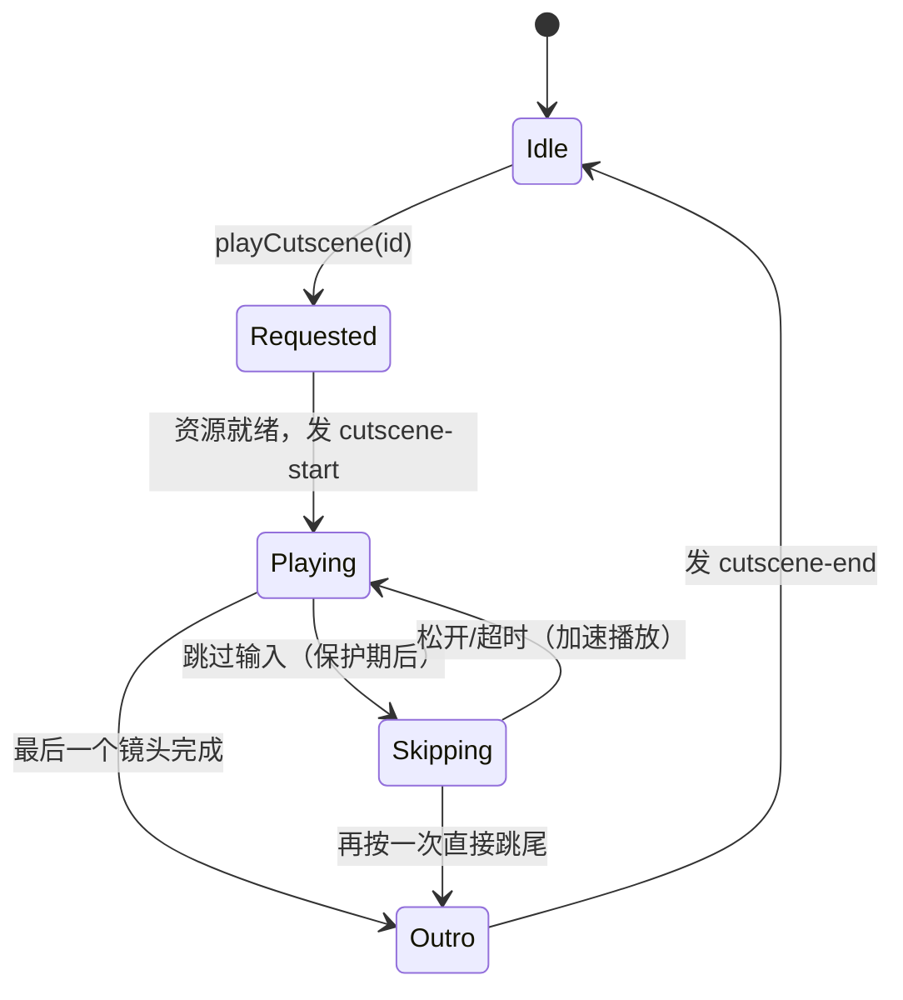

# 31 · 过场动画、失败 / 未完待续画面与音频系统

> 模块 M3 · 过场 / 音频｜负责人 narrative-content｜上游 `docs/00-brief.md`（§4 状态与事件、§5 数值、§6 音频 ID、§8 文案）｜下游 10-gameplay、20/21、40-ui-ux、50-engine
> 画面全部为**代码生成的扁平矢量**：圆 / 矩形 / 线段 / 多边形 + 纯色块 + 2–3px 描边，不依赖外部图片；**无视频文件、无序列帧导出**，移动端与 PC 共用同一套逻辑坐标与时间轴。

## 1. 目标与范围

**做什么**

- 第一关商店购买后的完整平面动画分镜（≈6s，五个镜头，逐镜给构图/图层/动画/时长/缓动/音效/跳过规则）。
- 第二关 Boss 巨大化过场、失败画面（含 `sfx.fail` 接入与缺失兜底）、「未完待续」画面。
- 音频总则（逻辑 ID → 文件、缺失静默 + warn 一次、并发优先级）、完整音频清单、BGM 切换与 ducking。
- 过场 / 失败覆盖层状态机、BGM 切换规则，数据结构与扩展点，可测验收 checklist。

**不做什么**

- 不定义商店逻辑、价格、Boss 血量与阶段判定（M1/M2 负责，本模块只消费 `game:shop-purchased` / `game:boss-phase` / `game:fail`）。
- 不定 UI 布局与响应式断点（M4）；本模块给文案与字号层级。
- 不写代码、不新增音频逻辑 ID（严格等于简报 §6 的 18 个）；不做视频、不做序列帧。
- 第二关 Boss 名称未定，统一用「第二关 Boss」占位。

## 2. 机制与规则

### 2.1 过场总则

- 只由事件触发（`game:shop-purchased`、`game:boss-phase`），进入全局 `Cutscene` 状态并发 `game:cutscene-start`；结束发 `game:cutscene-end`，回 `Playing` 或进 `LevelClear`。
- 输入封锁与画面包装：过场期间移动/跳跃/射击/交互全部无效，只响应「跳过」，HUD 按配置淡出；上下各 `cs.letterbox` 黑边滑入，所有元素画在 960×540 逻辑坐标内，与 DPR 和 letterbox 缩放解耦。
- 可跳过：任意键 / 点击 / 触控「跳过 ▸▸」；开局 `cs.skipGuard` 内忽略；第一次跳过把剩余时间加速到 `cs.skipSpeed` 倍，再按直接跳到 `cs.skipTail` 收尾段。跳过不得改变状态迁移结果。
- 互斥：同一时刻只允许一个过场；播放中收到新请求返回 `busy`。**失败优先级最高**：过场中满足失败条件先挂起，`Outro` 后进入 Fail（见 §2.4）。
- 时间轴按**真实时间**推进，与帧率无关；单帧跨镜头时直接快照到目标状态，不补播中间镜头。

### 2.2 第一关购买过场（≈6s）

- 触发：商店完成购买（`game:shop-purchased`，购买物为子弹枪；介绍文案「潮的馈赠」由本模块提供，商店展示归 M4）。
- 五个镜头：气泡 → 潮夺枪 → 慢动作开枪 → 闪白/速度线/Boss 倒地 → 结算；时长分解见 §5.1（引用简报 §5 的 2.2 / 0.4 / 1.2 / 1.5 / 0.7 s）。
- 仅在过场出现的蒙面剪影同学「潮」从画面右侧冲入夺枪、一枪击毙笑长，随后把枪抛回主角（解释「潮的馈赠」）；其身份不解释，留给后续关卡。笑长气泡固定文案见 §5.1 镜头 A；跳过时仍写 memes「大四人」。
- 期间 BGM 保持 `bgm.boss1` 并 duck（§2.8）；慢动作**不影响音频时钟**。
- 结束：`game:cutscene-end` → 发 `game:boss-defeated` 由 M2 处理 → 进 `LevelClear(1)`（`game:level-complete` 由 M1 发）。

### 2.3 第二关 Boss 巨大化过场（≈2.4s）

- 触发：M2 判定 Boss 血量达到巨大化阈值，冻结 Boss AI 并请求播放 `boss2-giant`；本模块只表演，不改 Boss 数值与阶段。
- 四阶段：预警（抖动 + 感叹符号）→ 变形（缩放 + 变色 + 拉远镜头 + 慢动作）→ 咆哮（拟声 + 震屏）→ 交手（清空子弹、恢复 timeScale）。
- 玩家在此过场中无敌（`cutscene-start` 后由 M1 置位，结束撤销），避免被冲击波击杀造成状态错乱。
- 可跳过，但跳过仍执行阶段迁移与子弹清空；`cutscene-end` 之前 M2 不得提前开启巨型阶段攻击。

### 2.4 失败画面与 `sfx.fail` 接入

- 触发：M1/M2 发 `game:fail{reason}`（`hp` / `coin` / `sight`）。进入 `Fail` 覆盖层，世界先以 `fail.freezeScale` 定格 `fail.freeze`，再完全暂停。
- 画面：黑幕淡入 `fail.veilIn` 到 `fail.veilAlpha`，标题 + 原因副标题 + 重试按钮；BGM 在同一淡入内降到 0。
- **失败音效接入规范**：逻辑 ID `sfx.fail`，文件 `public/audio/fail.ogg`。失败画面出现瞬间调 `AudioManager.play('sfx.fail')`，只播一次、不循环、不等待播放结束再出 UI。**文件缺失或解码失败 → 完全静默，控制台每 ID 只 `warn` 一次**（`[audio] missing sfx.fail (public/audio/fail.ogg)`），不弹窗、不阻塞、不重试；兜底链 `fail.ogg → fail.mp3 → fail.m4a`，全缺才静默。用户稍后放入文件即自动生效，**无需改代码**。
- 重试：按钮「重试」、键 `R` / `Enter`、触控点按；`fail.retryCooldown` 内去重；点击后淡出 0.25s → 发 `game:retry`，回当前房间/阶段检查点（M1 定义）。失败音效不会因重试重播，再次进入失败画面才再播一次。
- 失败画面不可跳过，只能重试离开；不计入剧情梗。

### 2.5 「未完待续」画面

- 触发：`LevelClear(2)` → `ToBeContinued`（顶层状态机名不可改）；黑幕后逐字显示固定文案「未完待续」，停留 `tobe.hold`，再出现「回到标题」按钮。
- 表现：纯文字 + 极简几何装饰（横线 + 圆点），无角色、不新增音效；`bgm.level2` 在 `tobe.bgmFade` 内淡出。
- 存档：`progress` 记录已通关、`stats` 记录通关时间（写入归 M0/M1，本模块只发事件）。
- 可跳过：只跳过逐字与停留，直接显示按钮；文案仍完整，不允许跳过成黑屏。

### 2.6 音频总则（全 ID 静默兜底）

- ID → 文件：`sfx.*` / `bgm.*` → `public/audio/<name>.ogg`（见 §2.7），`sfx.fail` 例外说明见 §2.4。
- **缺失兜底**：文件不存在或解码失败 → 静默；`console.warn` 每 ID 只一次（内部 Set），后续同 ID 直接跳过；不抛异常、不反复请求、不影响流程。ogg 优先，移动端 Safari 支持有限时按兜底链回退，不阻塞游戏。
- **自动播放策略**：首次用户手势（点击/按键）后 `AudioContext.resume()`；未解锁前播放请求排队丢弃而非报错；Title 必须有「点击开始」（M4 实现，本模块要求）。
- **并发与优先级**：同时最多 `audio.maxSfx` 条；同 ID 在 `audio.dedupe` 内去重；P0 可抢占 P2（停最早的低优先级音），P1 只丢新不改旧。
- **音量**：最终音量 = `settings.master × bus × 单条音量`；音量滑杆为 0 视为用户静音，**不触发缺失 warn**。
- **时间轴独立**：慢动作/暂停不改变音频播放速率（`sfx.gunshot` 在 timeScale 0.25 下仍正常速），BGM 只变音量不变速。
- **格式**：ogg 优先；移动端 Safari 对 ogg 支持有限，按兜底链回退（§10），不因此阻塞游戏。

### 2.7 音频清单

| 逻辑 ID | 触发点 | 占位文件 | 音量 | 优先级 | 循环 | 缺失兜底 |
|---|---|---|---|---|---|---|
| `sfx.fail` | 失败画面出现瞬间 | `public/audio/fail.ogg`（用户提供） | 0.9 | P0 | 否 | 静默 + warn 一次 |
| `sfx.jump` | 玩家起跳 | `public/audio/jump.ogg` | 0.5 | P2 | 否 | 静默 + warn 一次 |
| `sfx.land` | 落地（含 Boss 倒地落地） | `public/audio/land.ogg` | 0.5 | P2 | 否 | 静默 + warn 一次 |
| `sfx.coin` | 拾取金币、获得道具/彩蛋 toast | `public/audio/coin.ogg` | 0.6 | P2 | 否 | 静默 + warn 一次 |
| `sfx.hurt` | 玩家/Boss 受击、假生扣血 | `public/audio/hurt.ogg` | 0.8 | P1 | 否 | 静默 + warn 一次 |
| `sfx.shop` | 进入商店 / 货架刷新 | `public/audio/shop.ogg` | 0.7 | P2 | 否 | 静默 + warn 一次 |
| `sfx.purchase` | 购买成功、夺枪动作 | `public/audio/purchase.ogg` | 0.7 | P1 | 否 | 静默 + warn 一次 |
| `sfx.gunshot` | 开枪（慢动作镜头） | `public/audio/gunshot.ogg` | 0.85 | P0 | 否 | 静默 + warn 一次 |
| `sfx.laser` | 笑长激光发射 | `public/audio/laser.ogg` | 0.6 | P1 | 否 | 静默 + warn 一次 |
| `sfx.warning` | 视线预警、激光 telegraph、假生预警 | `public/audio/warning.ogg` | 0.8 | P1 | 否 | 静默 + warn 一次 |
| `sfx.dialogue` | 对话气泡、过场字幕 | `public/audio/dialogue.ogg` | 0.5 | P2 | 否 | 静默 + warn 一次 |
| `sfx.buff` | 老吴增益生效 | `public/audio/buff.ogg` | 0.7 | P2 | 否 | 静默 + warn 一次 |
| `sfx.phase` | Boss 阶段转换、巨大化开始 | `public/audio/phase.ogg` | 0.85 | P0 | 否 | 静默 + warn 一次 |
| `bgm.title` | Title 界面（首次手势后） | `public/audio/title.ogg` | 0.5 | 背景 | 是 | 静默 + warn 一次 |
| `bgm.level1` | 第一关普通房间 | `public/audio/level1.ogg` | 0.45 | 背景 | 是 | 静默 + warn 一次 |
| `bgm.boss1` | 第一关 Boss 房、购买过场 | `public/audio/boss1.ogg` | 0.55 | 背景 | 是 | 静默 + warn 一次 |
| `bgm.level2` | 第二关普通房间、未完待续 | `public/audio/level2.ogg` | 0.45 | 背景 | 是 | 静默 + warn 一次 |
| `bgm.boss2` | 第二关 Boss、巨大化过场 | `public/audio/boss2.ogg` | 0.55 | 背景 | 是 | 静默 + warn 一次 |

### 2.8 BGM 切换与 ducking

| 游戏状态 | BGM | 切换方式 |
|---|---|---|
| Title | `bgm.title` | 首次手势后淡入；开始游戏淡出 |
| Level1 普通房间 | `bgm.level1` | crossfade |
| Level1 Boss 房 / 购买过场 | `bgm.boss1` | 进房 crossfade；过场 duck |
| Level2 / LevelIntro(2) | `bgm.level2` | crossfade |
| Level2 Boss / 巨大化过场 | `bgm.boss2` | 进房 crossfade；过场 duck |
| Paused | 当前曲 | duck |
| Fail | 当前曲淡出到 0 | `fail.veilIn` 内完成 |
| ToBeContinued | `bgm.level2` | 淡出，不切新曲 |

- 同曲请求 = no-op，不重启、不重置播放位置；切换统一 crossfade `audio.crossfade`。
- Ducking：受击 `audio.duckHurt`（起 `audio.duckAttack`，恢复 `audio.duckRelease`）；过场 `audio.duckCutscene`；暂停 `audio.duckPause`。多个 duck 同时生效取最大值，解除后平滑回升。

## 3. 数值与参数表

> 分镜时长直接引用简报 §5（2.2 / 0.4 / 1.2 / 1.5 / 0.7 s），只在 §5.1 出现一次；音量只在 §2.7 出现一次。

| 参数名 | 建议默认值 | 单位 | 调参影响 |
|---|---|---|---|
| `cs.letterbox` | 32 | px | 黑边高度；过大会压缩可读画面 |
| `cs.letterboxIn` | 0.3 | s | 黑边滑入时长 |
| `cs.skipGuard` | 0.3 | s | 跳过保护期，防误跳过开场气泡 |
| `cs.skipSpeed` | 2.5 | × | 首次跳过的加速倍率 |
| `cs.skipTail` | 0.25 | s | 立即跳过后的收尾段 |
| `cs.zoomIn` | 1.06 | × | 购买过场镜头推近量 |
| `cs.zoomGiant` | 0.92 | × | 巨大化时镜头拉远量 |
| `cs.slowmoScale` | 0.25 | × | 慢动作 timeScale，越低越夸张 |
| `cs.bulletTravel` | 0.9 | s | 过场子弹飞行（scaled 时间），与战斗子弹无关 |
| `cs.flashWhite` | 0.12 | s | 闪白峰值持续 |
| `cs.flashPeak` | 0.9 | alpha | 闪白最大不透明度 |
| `cs.shakeHit` | 6 | px | Boss 倒地震屏幅度 |
| `cs.shakeGiant` | 8 | px | 巨大化咆哮震屏幅度 |
| `cs.shakeDecay` | 0.2 | s | 震屏衰减 |
| `cs.speedLines` | 8 | 条 | 速度线数量（≤12 防过载） |
| `fail.freezeScale` | 0.15 | × | 死亡瞬间慢速定格 |
| `fail.freeze` | 0.25 | s | 定格时长，之后完全暂停 |
| `fail.veilAlpha` | 0.72 | alpha | 失败黑幕不透明度 |
| `fail.veilIn` | 0.35 | s | 黑幕淡入 |
| `fail.retryCooldown` | 0.2 | s | 重试按钮去重 |
| `tobe.typeInterval` | 0.09 | s/字 | 「未完待续」逐字速度 |
| `tobe.hold` | 1.6 | s | 文案停留 |
| `tobe.buttonDelay` | 1.4 | s | 停留后按钮出现间隔 |
| `tobe.bgmFade` | 1.0 | s | 结束 BGM 淡出 |
| `audio.crossfade` | 0.8 | s | BGM 交叉淡化 |
| `audio.maxSfx` | 8 | 条 | 同时播放音效上限 |
| `audio.dedupe` | 80 | ms | 同 ID 去重窗口 |
| `audio.duckHurt` | 6 | dB | 受击时 BGM 压低 |
| `audio.duckCutscene` | 9 | dB | 过场时 BGM 压低 |
| `audio.duckPause` | 12 | dB | 暂停时 BGM 压低 |
| `audio.duckAttack` | 0.08 | s | duck 起始时间 |
| `audio.duckRelease` | 0.35 | s | duck 恢复时间 |

## 4. 流程 / 状态机

### 4.1 过场状态机



| 状态 | 玩家可做 | 时间轴 | 退出与事件 |
|---|---|---|---|
| Idle | 全部 | 无 | 收到请求 → Requested |
| Requested | 全部 | 正常 | 就绪 → Playing，发 `game:cutscene-start` |
| Playing | 仅跳过 | 真实时间 | 播完 → Outro |
| Skipping | 仅跳过 | `cs.skipSpeed` 倍 | 再按 → Outro |
| Outro | 无 | `cs.skipTail` | 发 `game:cutscene-end`，回 Playing / LevelClear |

### 4.2 失败覆盖层状态机

`Idle → Freezing（定格）→ VeilIn（黑幕 + `sfx.fail`）→ RetryReady（按钮可点）→ Retry（淡出）→ Idle`

| 状态 | 表现 | 音效 | 允许输入 |
|---|---|---|---|
| Freezing | 世界慢速定格 | 无 | 否 |
| VeilIn | 黑幕淡入、标题出现 | `sfx.fail` 一次 | 否 |
| RetryReady | 按钮可用 | 无 | 重试 / R / Enter |
| Retry | 淡出 0.25s，发 `game:retry` | 无 | 否 |

> BGM 的切换状态、同曲 no-op 与 ducking 见 §2.8，不单独建状态机。

## 5. 交互与表现（含逐字文案）

### 5.1 第一关购买过场时间轴

> 时长引用简报 §5；「起-止」为累计时间。全部元素为扁平矢量（圆 / 矩形 / 线段 + 描边 + 色块）。

| 镜头 | 起-止 (s) | 时长 | 画面构图与图层 | 动画类型 / 缓动 | 音效 ID |
|---|---|---|---|---|---|
| A 气泡 | 0.0–2.2 | 2.2 | L0 深灰礼堂背景 + L1 讲台矩形 + L2 笑长（大圆头 r=28、矩形身体、三角帽）+ L3 玩家（小圆头 r=10、蓝矩形）+ L4 白底黑描边圆角气泡 380×96、尾巴指向笑长，文字 20px「你这玩意能大四人你知道不」 + L6 上下黑边 | 气泡 `scale 0.7→1.05→1.0` easeOutBack 0.18s 后停留；整体上下浮动 ±1px 两次；镜头 `zoom 1.0→cs.zoomIn` easeOutCubic | `sfx.dialogue` |
| B 夺枪 | 2.2–2.6 | 0.4 | L2 右侧冲入潮（黑色圆头 r=12、深灰矩形身体 22×42、两条线段手臂、眼罩矩形 16×5，过场限定剪影）；枪＝矩形 24×8 + 握把 8×12，从玩家手移向潮的手中；L5 速度线 4 条 | 潮位移 x=+40→560（easeOutQuad）；枪位移 80px＋旋转 −180°（easeInOutQuad 0.22s）；玩家手臂后甩 20°；速度线 alpha 0.6→0 | `sfx.purchase` |
| C 慢动作开枪 | 2.6–3.8 | 1.2 | L4 枪口白色星形闪光 24px + 子弹（白圆 r=3 + 20px 拖尾）；子弹从枪口飞向笑长眉心 720px | `timeScale 1.0→0.25` 进入，`cs.bulletTravel` 内飞完，再回 1.0；镜头抖 1px；闪光 0.1s 淡出 | `sfx.gunshot` |
| D 命中 / 倒地 | 3.8–5.3 | 1.5 | L5 全屏白矩形闪白 + `cs.speedLines` 条速度线从四角向中心汇聚；L2 笑长后仰 15°，旋转 −85°、下坠 60px，落地 3 个灰色尘粒；枪从潮手中沿小抛物线抛回 L3 主角手部 | 闪白 alpha 0→`cs.flashPeak`→0（`cs.flashWhite`）；速度线 0.3s 缩短消失；倒地 easeInQuad 0.5s；落地震屏 `cs.shakeHit`（`cs.shakeDecay`）；抛枪 0.25s easeOutQuad；镜头回 1.0 | `sfx.hurt`、落地 `sfx.land` |
| E 结算 | 5.3–6.0 | 0.7 | L6 中央「第一关 · 过关」+ 副标题「笑长已倒地」；黑边保持 | 文案 alpha 0→1（0.2s easeOut）、缩放 0.9→1.0；无新音效，BGM 淡出 | — |

- 跳过：0–`cs.skipGuard` 内不可跳；之后任意输入加速到 `cs.skipSpeed`；再按跳至 5.75s 收尾（`cs.skipTail`），置 Boss 倒地并进入 E，`sfx` 不重播不叠加；跳过仍记录 memes「大四人」。

### 5.2 扁平矢量资源槽

- 玩家 `art/player`、笑长 `art/boss1`、潮 `art/npc/chao`（过场限定，不进常规房间）、子弹枪 `art/item/gun`、气泡 `art/ui/bubble`、黑边 `art/cutscene/letterbox`；全部由圆 / 矩形 / 线段组合 + 描边绘制，可整体替换为手绘素材。

### 5.3 第二关巨大化过场分镜（≈2.4s）

| 阶段 | 起-止 (s) | 画面 | 动画 / 缓动 | 音效 |
|---|---|---|---|---|
| 预警 | 0.0–0.4 | Boss 停火，头顶红色「!」，画面微暗 | Boss alpha 1→0.4 闪 3 次；镜头抖 2px | `sfx.warning` |
| 变形 | 0.4–1.6 | Boss 占满右侧 2/3；L5 速度线 4 条；镜头拉远 | `scale 1.0→1.6` easeInOutBack；暗红→深红；镜头 `zoom 1.0→cs.zoomGiant`；`timeScale 1.0→0.5→1.0` | `sfx.phase` |
| 咆哮 | 1.6–2.1 | 中央偏上拟声「吼——」；Boss 身体纵向拉伸 5% | 文字弹出 0.2s easeOutBack；震屏 `cs.shakeGiant` 0.35s | `sfx.phase`（一次播完） |
| 交手 | 2.1–2.4 | 敌我子弹淡出；回到常态缩放 | 子弹 alpha→0 0.08s；`timeScale` 复位 1.0；黑边滑出 | — |

- 跳过：立即执行变形终态 + 清子弹 + 恢复缩放，照常发 `game:cutscene-end`；阶段切换在 end 之后由 M2 执行。
- 玩家过场中无敌；若失败条件已满足，过场结束后再进 Fail。

### 5.4 失败画面文案与表现

| 元素 | 逐字文案 | 字号 | 出现时机 |
|---|---|---|---|
| 主标题 | `你又没了` | 36px | 黑幕后 0.15s 淡入 |
| 原因（hp / coin / sight） | `血量见底。` / `金币见底。` / `被笑长看见了。` | 20px | 主标题后 0.2s |
| 按钮 | `重试` | 20px | 按钮淡入后可用 |
| 按钮提示 | `R / Enter` | 14px | 按钮下方，仅 PC 显示 |

- `sfx.fail` 与主标题同时触发；缺失静默（§2.4）；每次进入失败画面最多播一次。

### 5.5 「未完待续」文案与表现

| 元素 | 逐字文案 | 字号 | 出现时机 |
|---|---|---|---|
| 主文案 | `未完待续` | 36px | 黑幕后逐字显示（`tobe.typeInterval`） |
| 副文案 | `第二关 · 完` | 18px | 主文案完成后 0.3s |
| 按钮 | `回到标题` | 20px | 副文案后 `tobe.buttonDelay` |
| 版本小字 | `v0.1` | 12px | 屏幕左下角常驻 |

- 装饰：主文案上下各一条 200×2px 横线 + 两端圆点；无角色、无音效；跳过只跳逐字与停留。

### 5.6 其他叙事文案（供 LevelIntro / UI 使用）

| 场景 | 逐字文案 | 备注 |
|---|---|---|
| 子弹枪道具介绍 | `潮的馈赠` | 购买确认与结算卡片；商店布局归 M4 |
| 第二关开局补给（旁白） | `老吴塞给你一沓钱。` | LevelIntro(2) 字幕，16px 旁白 |
| 第二关开局补给（老吴气泡） | `够你死几回了。` | 20px 气泡；同时 HUD 金币滚动到初始值（简报 §5） |

## 6. 边界与异常

| 场景 | 期望行为 |
|---|---|
| 连点跳过 | `cs.skipGuard` 内忽略；加速中再按只进一次 Outro；`sfx` 不重复 |
| 慢动作中跳过 / 失败 | `timeScale` 必须复位 1.0；无残留慢动作、闪白、速度线图层 |
| 过场中触发失败 | 挂起失败，Outro 后定格进 Fail；不打断过场、不丢 `cutscene-end` |
| 切后台 / 失焦 | 过场时钟暂停，回前台继续；`hidden` 超 5s 直接跳到当前镜头末尾 |
| 低帧（<30fps） | 时间轴按真实时间积分，跨镜头直接快照终态，不追帧 |
| 双过场请求 | 返回 `busy` 排队或丢弃；Fail 优先级最高 |
| 音频缺失 / 损坏 | 静默 + 每 ID warn 一次；不阻塞、不弹窗、不重试请求 |
| 自动播放被拦截 | 首次手势前请求丢弃；Title「点击开始」后恢复 |
| `sfx.fail` 未交付 | 失败画面完整可用、静默；放入文件后自动播，无需改代码 |
| 减少动效开启 | 闪白 alpha 减半、速度线关闭、震屏减半、慢动作保留 0.6×；文案信息不丢 |
| 闪烁安全 | 全屏闪白间隔 ≥1s、每秒闪烁 ≤3 次；失败红闪不叠加 |

## 7. 与其他模块的接口

**接收事件**

| 事件 | 载荷 | 用途 |
|---|---|---|
| `game:shop-purchased` | `{ itemId }` | 触发第一关购买过场 |
| `game:boss-phase` | `{ phase, bossId }` | 触发第二关巨大化过场 |
| `game:fail` | `{ reason }` | 进入失败画面 |
| `game:level-complete` | `{ level }` | 触发第二关「未完待续」 |
| `game:retry` | `{}` | 失败画面退场、BGM 恢复 |
| `settings` | `master/bgm/sfx/reducedMotion` | 音量与减少动效 |

**发出事件**

| 事件 | 载荷 | 消费方 |
|---|---|---|
| `game:cutscene-start` | `{ id }` | M1（输入封锁/无敌）、M4（隐藏 HUD）、音频（duck） |
| `game:cutscene-end` | `{ id, skipped }` | M1、M2（应用阶段）、音频（恢复 duck） |
| `game:boss-defeated` | `{ bossId }` | M2（第一关） |
| `game:fail-screen-open`（建议） | `{ reason }` | 存档（死亡次数）、M4 |
| `game:meme-unlocked` | `{ memeId }` | 跳过购买过场时记录梗 |

**数据结构建议**

```json
CutsceneDef = {
  "id": "shop-purchase-l1", "canSkip": true, "bgm": "boss1", "shots": [
    { "type": "bubble", "at": 0.0, "dur": 2.2, "text": "你这玩意能大四人你知道不" },
    { "type": "slowmo", "at": 2.6, "dur": 1.2, "scale": 0.25 },
    { "type": "text", "at": 5.3, "dur": 0.7, "text": "第一关 · 过关" }
  ], "onEnd": ["boss-defeated", "level-complete"]
}
```

**依赖文件**：`src/content/cutscenes.ts`、`src/content/audio.ts`（ID→文件注册表）、`src/systems/cutscene.ts`、`src/systems/audio.ts`；资源槽 `art/cutscene/letterbox`、`art/ui/bubble`、`art/item/gun`。

## 8. 扩展点

- **加过场**：`cutscenes.ts` 写一条 `CutsceneDef`（shot 类型见 §5.1 / §7）+ 触发处调 `playCutscene(id)`，不改系统；新 shot 类型只需加一个 renderer。
- **加音效**：`audio.ts` 注册表加一行（ID、文件、音量、优先级、loop），缺失自动静默；新 ID 必须先写进简报 §6 再同步本文 §2.7。
- **加 BGM**：§2.8 映射表加一行，不改切换逻辑，同曲 no-op 自动生效。
- **加失败原因**：`game:fail.reason` 加枚举 + §5.4 文案表加一行，画面结构不变。
- **替换美术**：所有元素都有资源槽（§5.2），换手绘 PNG 时按槽替换，坐标与时间轴不变。

## 9. 验收标准

- [ ] 购买后自动播放 5 镜头过场，累计 ≈6s，顺序与 §5.1 一致；每镜构图/图层/缓动/音效命中，慢动作结束 `timeScale` 恢复 1.0。
- [ ] `cs.skipGuard` 内不可跳；加速跳过后直接收尾，Boss 仍倒地、`level-complete` 只发一次。
- [ ] 过场期间移动/跳跃/射击/交互全部无效，结束恢复。
- [ ] 笑长气泡逐字为「你这玩意能大四人你知道不」，20px。
- [ ] 巨大化过场 4 阶段完整播放，跳过也完成阶段迁移与子弹清空。
- [ ] 失败画面：定格 → 黑幕 → 标题/原因/按钮；`sfx.fail` 只播一次，缺失静默且 warn 只一次。
- [ ] `public/audio/fail.ogg` 放入后无需改代码即可播放，删除后回到静默。
- [ ] 重试按钮、`R`、`Enter`、触控都能发 `game:retry`，`retryCooldown` 内不重复。
- [ ] 失败时 BGM 淡出到 0，重试后恢复对应 BGM。
- [ ] 「未完待续」逐字显示主文案/副文案/按钮，BGM 淡出。
- [ ] 音频清单 18 个 ID 与简报 §6 完全一致，缺失兜底统一。
- [ ] BGM 按 §2.8 切换；同曲 no-op；受击 ducking 可感知且平滑恢复；慢动作下音效正常速。
- [ ] 减少动效开启后闪白/速度线/震屏按规则减弱，文案信息不丢。
- [ ] 全程无外部图片/视频依赖：几何图形 + 文字 + 可选占位音频。

## 10. 风险与待确认

| # | 假设 / 风险 | 需要谁拍板 |
|---|---|---|
| 1 | `sfx.fail` 用户只给 ogg；iOS Safari 对 ogg 支持差，兜底链 `ogg→mp3→m4a` 已写，建议补 mp3 | 用户 |
| 2 | 音频文件统一放 `public/audio/<逻辑名>.ogg`；若命名不同需改注册表 | 用户 / M5 |
| 3 | 其余音效与全部 BGM 是否提供；不提供则全程静默，游戏必须可玩（已按此设计） | 用户 |
| 4 | 购买过场跳过会错过笑长梗；已用 memes 保底，是否要做「回看」入口由 M4 定 | M4 |
| 5 | 第二关 Boss 名称未定，文案统一占位「第二关 Boss」 | 用户 |
| 6 | 第二关开局金币来源定为老吴塞钱（§5.6），M2 若有不同叙事需同步 | M2 / Lead |
| 7 | 过场中禁止失败是否影响手感；若 M1 要失败立即打断，需额外处理 `cutscene-end` 一致性 | M1 |

## 11. 与其他模块的接口汇总

| 方向 | 对方模块 | 内容 |
|---|---|---|
| 给我 | M1 | `game:shop-purchased`、`game:fail`、检查点/重试、输入封锁与无敌开关 |
| 给我 | M2 | `game:boss-phase`、Boss 阶段判定与倒地后的胜负结算 |
| 给我 | M4 | 播放器容器、按钮与字幕样式、安全区、减少动效设置项 |
| 给我 | M0 | `settings` 音量字段、`progress` 已看过场、`memes` 写入 |
| 我给 | M1 | `game:cutscene-start/end`、`game:boss-defeated` 时序约定 |
| 我给 | M2 | 巨大化过场结束信号（阶段切换必须在 `cutscene-end` 之后） |
| 我给 | M5 | 18 个音频 ID 注册表、缺失兜底规范、`CutsceneDef` 结构、验收清单 |
| 我给 | 用户 | `sfx.fail` 接入点与路径（`public/audio/fail.ogg`），放入即生效 |
